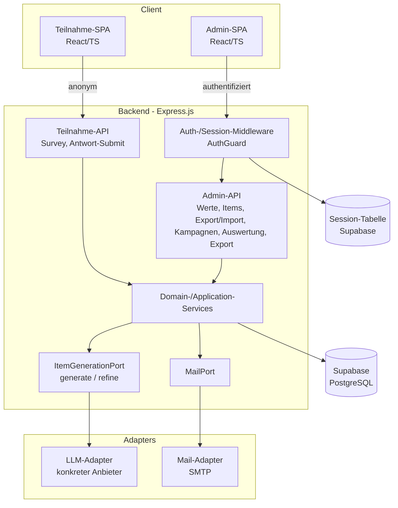
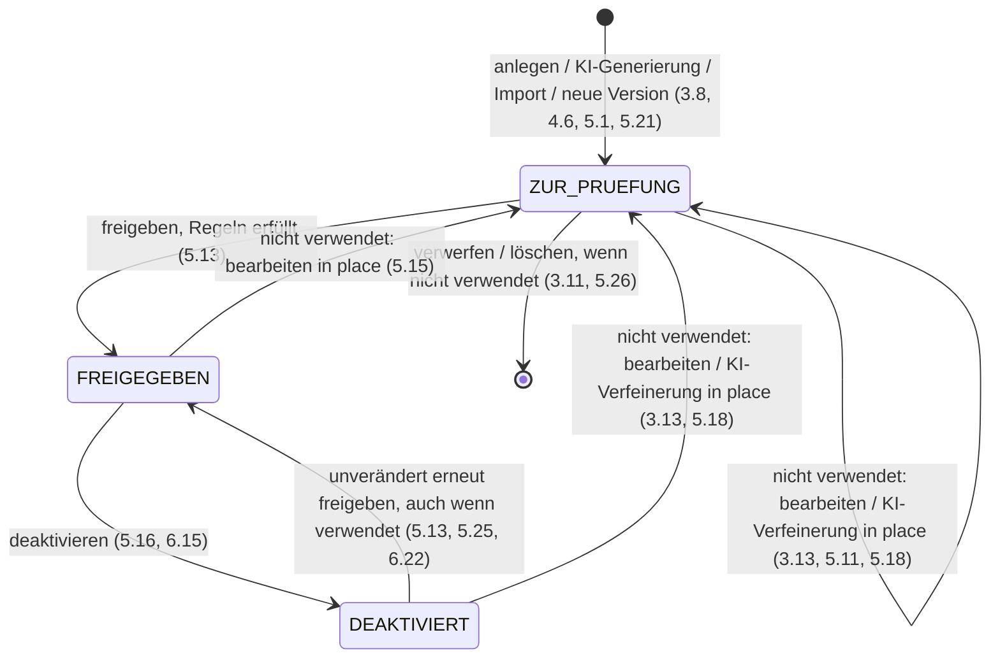
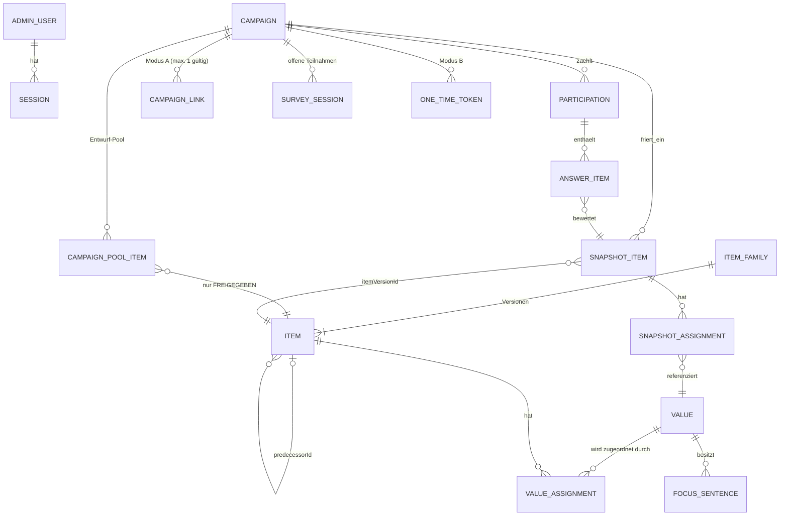

# Design Document

## Overview

Das Kulturbarometer ist eine Webapplikation, die den gelebten Ist-Zustand der Unternehmenskultur erhebt. Sie besteht aus zwei klar getrennten Zugangsbereichen:

- **Administrationsbereich** (authentifiziert): Verwaltung von Unternehmenswerten, Fokussätzen, KI-gestützter Item-Generierung und -Verfeinerung, Item-Export/-Import, Items samt Freigabe-Workflow, Kampagnen, Verteilung, Auswertung und Export.
- **Teilnahmebereich** (anonym): Beantwortung der Umfrage einer aktiven Kampagne über einen öffentlichen Kampagnen-Link oder einen individuellen Einmal-Link.

Das zentrale fachliche Alleinstellungsmerkmal ist die **dreifache Perspektive** (Selbst, Team, Führung): Jedes Item trägt genau eine in seiner Formulierung ausgedrückte Perspektive, und der gewichtete **Ist-Score** wird je Unternehmenswert **und** je Perspektive getrennt berechnet. Hinzu kommen zwei Wege der Item-Entstehung (**KI-gestützte Generierung/Verfeinerung** über einen API-Zugang oder **JSON-Export/-Import** für externe Erstellung), ein **Item-Statusmodell** (zur Prüfung → freigegeben → deaktiviert), zwei **anonymitätswahrende Verteilmodi**, eine **zufällige Teilnehmer-Teilmenge** je Teilnehmer und ein **Kampagnen-Snapshot**, der reproduzierbare Berechnungen über die Zeit erlaubt. Der Snapshot ist nach Aktivierung unveränderlich; einzige Ausnahme ist die **Deaktivierung einzelner Items** während einer laufenden Kampagne, um missverstandene Items aus der Wertung zu nehmen. Damit Kampagnen auf derselben Fragenbasis vergleichbar bleiben, werden Items **versioniert**: Sobald eine Item-Version in einer aktivierten Kampagne verwendet wurde, ist sie unveränderlich; jede Änderung (manuell oder KI-gestützt) erzeugt eine neue Item-Version im Status `ZUR_PRUEFUNG`, die vorherige Version bleibt unverändert. Der Kampagnen-Pool einer früheren Kampagne lässt sich mit denselben Item-Versionen in eine neue Kampagne übernehmen. Eine Kampagne besteht aus einem Set von Fragen und Situationen/Use-Cases; ihre Unternehmenswerte werden nicht separat gepflegt, sondern aus den Werte-Zuordnungen dieser Items abgeleitet. Ausgewertet werden laufende Kampagnen (vorläufige, stufenweise aktualisierte **Zwischenauswertung**) und abgeschlossene Kampagnen (**Endauswertung**); beide zeigen Ergebnisse erst ab einer je Kampagne festgelegten **Anonymitätsschwelle**. Ausgewertet wird auf Ebene der **Unternehmenswerte im Kontext der drei Perspektiven**, nicht auf Ebene einzelner Items: neben dem Mittelwert (Ist-Score) die **Verteilung** der Teilnehmer-Scores (Klassen, Median, Standardabweichung) und die **Perspektivdifferenzen**.

Dieses Dokument beschreibt die Architektur, den Technologie-Stack, das Datenmodell, die Komponenten, die zentralen Abläufe, die Korrektheitseigenschaften (für Property-Based Testing), die Fehlerbehandlung sowie ein Sicherheits- und Datenschutzkonzept, das die Anonymität der Teilnehmer in den Mittelpunkt stellt.

### Designziele und Leitprinzipien

- **Anonymität by design**: Keine personenbezogenen Identifikationsdaten (Name, E-Mail, IP, Benutzerkennung) werden zusammen mit Antworten gespeichert. Im E-Mail-Verteilmodus wird die Adresse ausschließlich transient zum Versand verwendet und nie persistiert (Anforderung 7.7, 8.9).
- **Reproduzierbarkeit**: Der Kampagnen-Snapshot friert Items, Werte-Zuordnungen und Gewichtungen bei Aktivierung ein, sodass Berechnungen und Verlauf stabil bleiben (Anforderung 6.13, 6.14, 6.24). Die einzige zulässige Änderung ist das Setzen von `deactivatedAt` an einem SnapshotItem (6.14, 6.15); Texte, Zuordnungen und Gewichtungen bleiben unverändert.
- **Unveränderlichkeit verwendeter Item-Versionen und Vergleichbarkeit**: Eine Item-Version, die Teil eines Snapshots einer aktivierten Kampagne ist, gilt als „verwendet" und ist unveränderlich und nicht löschbar (5.19, 5.20, 5.27). Änderungen führen zu einer neuen Item-Version (5.21, 5.22); Kampagnen, die dieselben Item-Versionen nutzen, rechnen auf identischen Texten und Gewichtungen und sind damit vergleichbar (6.7, 6.24).
- **Qualitätssicherung der Items**: Nur freigegebene Item-Versionen gelangen in Kampagnen-Pools und Umfragen (5.17, 6.5). Items aus KI und Import durchlaufen denselben Prüf- und Freigabe-Workflow.
- **Austauschbarkeit der KI**: Die LLM-Anbindung ist als Port/Adapter gekapselt, sodass der konkrete Anbieter ersetzbar ist und KI-Ausgaben als nicht vertrauenswürdig behandelt werden (Anforderung 3).
- **Importierte Dateien sind nicht vertrauenswürdig**: Item-Importe werden wie externe Eingaben mit derselben strikten Validierung wie manuell erfasste Items behandelt (Anforderung 4).
- **Anonymitätsschwelle in der Auswertung**: Ist-Scores, Bewertungsanzahlen und Freitextkommentare werden erst angezeigt bzw. exportiert, wenn kampagnenweit genügend Antworten und je Wert/Perspektive genügend beitragende Teilnehmer vorliegen (6.28–6.30, 10.6, 10.13, 10.14, 11.7, 11.8). Die Zwischenauswertung einer laufenden Kampagne springt nur in Stufen der Schwelle weiter, damit sich einzelne Antworten nicht durch Vergleich zweier Abrufe herausrechnen lassen (10.12).
- **Trennung der Bereiche**: Administration und Teilnahme laufen über getrennte Routen, Middleware und Berechtigungen (Anforderung 1.4).

### Technologie-Stack

Verbindlich ist der in `.kiro/steering/tech.md` festgelegte Techstack: **React 19 + TypeScript + Vite** im Frontend, **Node.js + Express.js + TypeScript** im Backend (gemeinsame Typen mit dem Frontend) und **Supabase (PostgreSQL)** als Datenbank. Für die dort noch nicht festgelegten Bereiche (in der Tabelle mit *Vorschlag* gekennzeichnet) gelten die folgenden Angaben als unverbindliche Vorschläge bis zur Entscheidung:

| Schicht | Technologie | Begründung |
| --- | --- | --- |
| Frontend | **React 19 + TypeScript + Vite** (verbindlich); *Vorschlag:* React Router, TanStack Query | Komponentenbasierte UI für Admin-Formulare und den Schieberegler-Survey; TypeScript teilt Typen mit dem Backend; TanStack Query vereinfacht Server-State. |
| Backend | **Node.js + Express.js + TypeScript** (verbindlich) | Ein Sprach-/Typ-Ökosystem über Front- und Backend mit gemeinsamen Typen. Die Trennung Admin/Teilnahme wird über zwei getrennte Express-Router abgebildet; die Auth-Prüfung (`AuthGuard`) ist eine Express-Middleware, die ausschließlich vor den Admin-Router gehängt wird. Die fachlichen Module sind einfache TypeScript-Module mit expliziter Konstruktor-Injektion ihrer Ports (kein DI-Framework). |
| Persistenz | **Supabase (PostgreSQL)** (verbindlich) | Relationales Modell passt zu den stark verknüpften Entitäten (Wert↔Item↔Zuordnung↔Kampagne); transaktionale Integrität für Snapshot-Erzeugung, Versionierung, Deaktivierung und Antwort-Speicherung; `NUMERIC` für exakte Dezimalbewertungen; Constraints und Trigger sichern Invarianten auf Datenbankebene ab. |
| Datenbank-Zugriff | *Vorschlag:* direkte Postgres-Verbindung des Backends zur Supabase-Datenbank (z. B. `pg`/`postgres.js` mit typisierten Queries) für alle transaktionalen Abläufe; alternativ supabase-js mit Service-Key, wobei transaktionale Abläufe dann als Postgres-Funktionen (RPC) umgesetzt werden | Das Design verlangt mehrere Operationen in **einer Transaktion** inkl. Zeilensperren (`SELECT … FOR UPDATE`) – u. a. `activateCampaign`, `createNewVersion`, `deactivateSnapshotItem`, `submitAnswer`, `importItems`. supabase-js bietet über die REST-Schnittstelle keine clientseitigen Transaktionen; diese Abläufe müssen daher entweder über eine direkte Postgres-Verbindung oder als Datenbankfunktionen laufen. Der Datenbankzugriff erfolgt ausschließlich serverseitig; das Frontend greift nie direkt auf Supabase zu (Row Level Security bleibt aktiviert und gewährt anonymen Rollen keinen Zugriff). |
| Authentifizierung | *Vorschlag:* **serverseitige Sessions** (signierte, HTTP-only Session-Cookies) mit Session-Tabelle in der Supabase-Datenbank; Passwort-Hashing mit **Argon2id**. Alternative: Supabase Auth | Serverseitige Sessions erlauben sofortige Invalidierung bei Logout (Anforderung 1.5), Inaktivitäts-Timeout (Anforderung 1.6) und einen serverseitigen Lockout-Zähler (Anforderung 1.3). Bei Supabase Auth müssen Lockout (5 Fehlversuche/15 Minuten) und 30-Minuten-Inaktivitäts-Timeout zusätzlich im Backend durchgesetzt werden. |
| LLM-Integration | *Vorschlag:* **Port/Adapter** (`ItemGenerationPort`) mit konkretem Adapter (z. B. OpenAI/Azure OpenAI/Bedrock), austauschbar per Konfiguration | Entkoppelt Kerndomäne vom Anbieter; erlaubt Mock-Adapter in Tests; strukturierte Ausgabe wird validiert, bevor sie als Vorschlag erscheint. |
| E-Mail-Versand | *Vorschlag:* **SMTP/Transactional-Mail-Adapter** (z. B. Nodemailer über einen Provider) | Nur transienter Versand der Einmal-Links; keine Persistenz der Adresse. |
| Validierung | *Vorschlag:* **Zod** (Frontend + Backend); JSON-Schema-Ausgabe für den Item-Export aus dem Zod-Schema (z. B. `z.toJSONSchema` ab Zod 4 bzw. `zod-to-json-schema`) | Geteilte Schema-Validierung für Eingaben (Textlängen, Gewichtungsbereiche, Bewertungsbereich). Ein einziges **geteiltes Item-Schema** dient ItemsModule, ItemGenerationModule und ItemExchangeModule; die Schemabeschreibung des Exports wird daraus abgeleitet und kann so nicht von der Validierung abweichen. |
| Tests | *Vorschlag:* **Vitest** + **fast-check** (Property-Based Testing) | fast-check deckt die universellen Eigenschaften der Ist-Score-Mathematik, der Teilmengen-Ziehung, der Deaktivierung und des Import-Round-Trips über viele Eingaben ab. |

Der Stack ist bewusst gängig und leichtgewichtig; Supabase/PostgreSQL deckt die relationalen Anforderungen, die Transaktionen und die exakte Dezimalarithmetik ab, ohne eine schwergewichtige Infrastruktur zu erfordern. Die fachlichen Designentscheidungen unten sind unabhängig vom konkreten Datenbank-Zugriffsweg gültig.

## Architecture

### Systemüberblick



### Schichtenmodell

- **Präsentations-/API-Schicht**: Zwei getrennte Express-Router. Admin-Routen sind durch die Auth-Middleware (`AuthGuard`) geschützt (Anforderung 1.4). Teilnahme-Routen sind öffentlich, aber an Link-/Token-Gültigkeit und Kampagnenstatus gebunden (Anforderung 7, 8).
- **Application-/Domain-Schicht**: Reine Fachlogik (Validierungsregeln, Item-Statusübergänge, Ist-Score-Berechnung, Teilmengen-Ziehung, Snapshot-Erzeugung, Import-Prüfung). Diese Schicht ist frei von I/O und damit gut per PBT testbar.
- **Infrastruktur-/Adapter-Schicht**: Persistenz (Supabase/PostgreSQL), LLM-Port, Mail-Port, Session-Tabelle. Ports isolieren externe, nicht vertrauenswürdige bzw. austauschbare Abhängigkeiten.

### Trennung von Admin und Teilnahme

Die beiden Bereiche teilen sich dieselbe Codebasis, aber getrennte Einstiegspunkte und Berechtigungen. Ein nicht authentifizierter Aufruf einer Admin-Funktion wird von der Auth-Middleware (`AuthGuard`) abgewiesen und auf die Anmeldeseite umgeleitet, ohne Funktionsdaten auszuliefern (Anforderung 1.4). Teilnahme-Endpunkte geben niemals Admin-Daten oder Rohantworten anderer Teilnehmer aus.

### Item-Statusmodell

Jede Item-Version besitzt genau einen Status (5.12). Es gibt keine separate Entwurfs-Entität: Ein generierter oder importierter Vorschlag ist einfach eine `Item`-Version im Status `ZUR_PRUEFUNG`. Begründung: GeneratedItemDraft und Item hätten dieselben Felder, dieselben Validierungsregeln (3.6, 3.7, 3.10, 4.4 verweisen auf Anforderung 5) und dieselben Aktionen (bearbeiten, verfeinern, freigeben, verwerfen). Ein einziges Modell vermeidet Kopier-/Mapping-Logik und doppelte Validierung.

**„Verwendet" ist ein orthogonales Kennzeichen, kein Status.** Eine Item-Version ist verwendet, sobald sie Teil eines Snapshots einer aktivierten Kampagne (Status `AKTIV` oder `ABGESCHLOSSEN`) ist (5.19). Die Zugehörigkeit zu einem Entwurfs-Pool zählt nicht (5.19). Technisch wird das Kennzeichen als `Item.usedAt` (nullable, einmalig in der Aktivierungstransaktion gesetzt, 6.13) geführt. Der Status gehört zur Item-Version und ändert nie ihren Inhalt (Glossar „Item-Status"). Das Kennzeichen steuert, ob Bearbeiten und Verfeinern **in place** (nicht verwendet) oder **als neue Version** (verwendet) erfolgen.



Für **verwendete** Versionen (Status `FREIGEGEBEN` oder `DEAKTIVIERT`) gibt es keinen Übergang auf derselben Zeile: Bearbeiten und Verfeinern erzeugen eine **neue Version** (eigene Zeile, Start im Zustand `ZUR_PRUEFUNG`, Pfeil `[*] → ZUR_PRUEFUNG`), die Vorgängerversion behält Inhalt und Status (5.21, 5.23, 3.14, 6.23).

Regeln:
- **Freigabe** (`approveItem`) wendet dieselben Gültigkeitsregeln wie die Item-Verwaltung an (5.1–5.9). Bei Verletzung bleibt der Status erhalten, die Fehlermeldung benennt die verletzte Regel (5.14). Die unveränderte Freigabe einer verwendeten, deaktivierten Version ändert ausschließlich den Status (5.25, 6.22).
- **Bearbeiten einer nicht verwendeten, freigegebenen Version** setzt den Status auf `ZUR_PRUEFUNG` (5.15); bestehende Snapshots bleiben unberührt (5.31).
- **Bearbeiten/Verfeinern einer verwendeten Version** legt eine neue Version mit nächsthöherer Versionsnummer an; die neue Version wird wie ein neues Item behandelt (5.22).
- **Nur `FREIGEGEBEN`** darf einem Kampagnen-Pool zugeordnet werden (5.17, 6.4, 6.5); die Aktivierung prüft den Pool erneut und scheitert bei nicht freigegebenen Items (6.11).
- **Deaktivierung in laufender Kampagne** setzt zusätzlich `SnapshotItem.deactivatedAt` und den Quell-Item-Status auf `DEAKTIVIERT` (6.15); der Inhalt der Item-Version bleibt unverändert (5.16).

## Components and Interfaces

Die Fachlogik ist in Module gegliedert. Jedes Modul kapselt seine Entitäten, Validierungsregeln und Anwendungsfälle.

### AuthModule (Anforderung 1)

- Verantwortlich für Anmeldung, Abmeldung, Session-Erzeugung/-Invalidierung, Lockout und Inaktivitäts-Timeout.
- Schlüsselschnittstellen:
  - `login(credentials) -> Session | AuthError` – erstellt Session bei gültigen Daten (1.1), lehnt generisch ab (1.2), berücksichtigt Lockout (1.3).
  - `logout(sessionId) -> void` – beendet Session sofort und invalidiert Token (1.5).
  - `AuthGuard` (Express-Middleware) – schützt alle Admin-Routen (1.4) und erzwingt Inaktivitäts-Timeout von 30 Minuten (1.6).
  - `LoginAttemptPolicy` – zählt fehlgeschlagene Versuche je Benutzer in einem 15-Minuten-Fenster; sperrt nach 5 Fehlversuchen für mindestens 15 Minuten (1.3).

### ValuesModule – Unternehmenswerte & Fokussätze (Anforderung 2)

- `createValue`, `updateValue`, `deleteValue`, `listValues`.
- `addFocusSentence`, `updateFocusSentence`, `removeFocusSentence`.
- Regeln: Name 1–100 Zeichen, eindeutig und nicht nur Leerzeichen (2.1–2.3); Beschreibung 0–1.000 Zeichen; Fokussatz 1–500 Zeichen (2.4, 2.5); Löschschutz bei Verwendung in einer aktiven Kampagne (2.8, 2.9); Leerzustand-Hinweis (2.12). Werte werden Kampagnen nicht direkt zugeordnet; „in einer aktiven Kampagne verwendet" heißt: mindestens ein `SnapshotAssignment` eines SnapshotItems einer Kampagne im Status `AKTIV` zeigt auf den Wert. Da jede Snapshot-Version verwendet ist (`usedAt IS NOT NULL`), ist dieser Fall in der Prüfung auf verwendete Item-Versionen enthalten (2.9, 2.10).
- **Löschschutz durch verwendete Item-Versionen (2.8, 2.10)**: `deleteValue` prüft vor dem Löschen in einer Transaktion, ob mindestens eine `ValueAssignment` auf den Wert zeigt, deren `Item.usedAt IS NOT NULL` ist. In diesem Fall wird die Löschung abgelehnt (`ValueReferencedByUsedItemError`), der Wert bleibt unverändert, und die Meldung weist auf die Referenzierung durch verwendete Item-Versionen hin (2.10). Zusätzlich verhindert ein Fremdschlüssel `ValueAssignment.valueId → Value.id` mit `ON DELETE RESTRICT` als Datenbank-Sicherung das Löschen auch bei Umgehung der Domänenprüfung. Nur Werte ohne Referenz durch verwendete Versionen sind löschbar (2.8); `ValueAssignment`s nicht verwendeter Item-Versionen entfernt die Anwendung in derselben Transaktion explizit vor dem Löschen des Werts (der Fremdschlüssel bleibt `RESTRICT`). Hat eine nicht verwendete Version danach keine Zuordnung > 0 % mehr, setzt dieselbe Transaktion ihren Status auf `ZUR_PRUEFUNG` und entfernt sie aus allen Entwurfs-Pools (`CampaignPoolItem`) (2.13).
- **Bearbeiten bleibt erlaubt (2.7)**: Name, Beschreibung und Fokussätze eines Werts dürfen auch dann geändert werden, wenn verwendete Item-Versionen den Wert referenzieren. Verwendete Snapshots bleiben davon unberührt, da `SnapshotAssignment.valueNameAtSnapshot` den Namen zum Aktivierungszeitpunkt einfriert; `ValueAssignment.valueId` ist stabil.

### ItemGenerationModule – KI-gestützte Generierung und Verfeinerung (Anforderung 3)

- `generateItems(valueId) -> Item[]` – erzeugt je Fokussatz drei Varianten (Selbst/Team/Führung) über den `ItemGenerationPort` (3.1, 3.3). Die validierten Ergebnisse werden als `Item` im Status `ZUR_PRUEFUNG` angelegt (3.8).
- `refineItem(itemId, instruction?) -> Item` – für Items im Status `ZUR_PRUEFUNG` oder `DEAKTIVIERT` (nicht verwendet) bzw. `FREIGEGEBEN`/`DEAKTIVIERT` (verwendet); `instruction` 0–1.000 Zeichen (3.13, 3.14). Die Operation verzweigt anhand `usedAt`:
  - **nicht verwendet**: Das validierte Ergebnis wird atomar an der Item-Version gespeichert und setzt den Status auf `ZUR_PRUEFUNG` (3.13, 5.18).
  - **verwendet**: Das validierte Ergebnis wird über `ItemsModule.createNewVersion(predecessorId, changes)` als neue Item-Version derselben Familie mit nächsthöherer Versionsnummer im Status `ZUR_PRUEFUNG` gespeichert; die verwendete Version bleibt unverändert (3.14, 5.21).
  - Die verfeinerte Item-Version bzw. neue Version wird erst nach erneuter Freigabe in Kampagnen und Umfragen verwendet (3.15). Die Verfeinerung einer nicht verwendeten, `FREIGEGEBEN`en Version bleibt abgelehnt (3.13); der Administrator bearbeitet sie stattdessen manuell (5.15) oder deaktiviert sie zuerst.
- `ItemGenerationPort` (Abstraktion):
  - `generate(input: ValueGenerationContext) -> RawItemSuggestion[]`
  - `refine(item: ItemSnapshotForAi, valueContext: ValueGenerationContext[], instruction?: string) -> RawItemSuggestion` – `valueContext` enthält Name, Beschreibung und Fokussätze aller dem Item zugeordneten Unternehmenswerte (3.13).
  - Konkrete Adapter (OpenAI/Azure/Bedrock/Mock) implementieren den Port; Auswahl per Konfiguration.
  - **Nicht vertrauenswürdige Ausgabe**: Jede Rohantwort von `generate` **und** `refine` wird gegen dasselbe strikte, geteilte Zod-Item-Schema validiert und bereinigt (Perspektive ∈ {Selbst, Team, Führung}, Item-Typ ∈ {Frage, Situation/Use-Case}, Text 1–500, Gewichtungen 0–100 %, mindestens eine Zuordnung > 0 %, Werte-Referenzen müssen existieren), bevor sie als Vorschlag erscheint (3.4, 3.5, 3.8).
- Prüf-Workflow über ItemsModule: `updateItem` (3.6, 3.7, 3.10), `approveItem` (3.9), `deleteItem` als Verwerfen eines Vorschlags (3.11).
- Fehlerfall Generierung: Schlägt sie fehl oder ist die Ausgabe ungültig, gilt immer die Konjunktion aus: keine Items gespeichert, Wert-Vorgaben unverändert und Fehlermeldung mit Wiederholungshinweis (3.12). Fehlender Fokussatz blockiert die Generierung (3.2).
- Fehlerfall Verfeinerung: Schlägt `refine` fehl oder ist die Ausgabe ungültig, wird **keine** Änderung am Item gespeichert, Item und Wert-Vorgaben bleiben unverändert, und es erscheint eine Fehlermeldung mit Wiederholungshinweis (3.16). Das gilt auch für die Verfeinerung einer verwendeten Version: Es wird **keine** neue Item-Version angelegt und die verwendete Version bleibt unverändert (3.16). Zur Atomarität läuft Validierung vor dem Schreiben; das Speichern (Änderung bzw. Anlegen der neuen Version) erfolgt in einer Transaktion.

### ItemExchangeModule – Item-Export und -Import (Anforderung 4)

- `exportItemSpecification() -> ItemExportFile | ExportError` – erzeugt eine JSON-Datei mit allen Unternehmenswerten (Name, Beschreibung, Fokussätze) und einer Schemabeschreibung (JSON Schema) für Items (4.1). Das JSON Schema wird aus dem geteilten Zod-Item-Schema abgeleitet und beschreibt Item-Text (1–500), Item-Typ, genau eine Perspektive sowie Werte-Zuordnungen mit `valueName` und Gewichtung 0–100 (4.2). Existiert kein Unternehmenswert, wird der Export abgelehnt, keine Datei erzeugt und ein Fehler mit Hinweis auf fehlende Werte geliefert (4.3).
- `importItems(fileContent: string) -> ImportReport | ImportRejected` – siehe Ablauf unten.
- Beispiel-Struktur der Datei:

```json
{
  "schemaVersion": 1,
  "values": [
    { "name": "Vertrauen", "description": "…", "focusSentences": ["…"] }
  ],
  "itemSchema": { "$schema": "https://json-schema.org/draft/2020-12/schema", "type": "object", "…": "…" },
  "items": [
    {
      "text": "Ich halte zugesagte Termine ein",
      "itemType": "FRAGE",
      "perspective": "SELBST",
      "assignments": [ { "valueName": "Vertrauen", "weight": 80 } ]
    }
  ]
}
```

- **Importablauf**:
  1. **Sicheres Parsen (nicht vertrauenswürdige Datei)**: Maximale Dateigröße (z. B. 2 MB) und maximale Item-Anzahl (z. B. 1.000) werden vor dem Parsen bzw. direkt danach geprüft; Überschreitung lehnt den gesamten Import ab. Geparst wird ausschließlich mit `JSON.parse` in einem try/catch (kein `eval`, keine Template-Ausführung); Zod-Schemata arbeiten im `strict`-Modus, unbekannte Schlüssel wie `__proto__` führen nicht zur Übernahme in Objekte. Item-Texte werden nie als HTML gerendert, sondern im Frontend als Text ausgegeben.
  2. **Top-Level-Prüfung**: Die Datei muss gültiges JSON sein und dem Top-Level-Schema entsprechen (Objekt mit `items`-Array, optional `schemaVersion`; `values` und `itemSchema` werden ignoriert). Andernfalls wird der **gesamte Import abgelehnt**, kein Item gespeichert, Fehler „ungültiger Dateiaufbau" (4.8).
  3. **Item-Prüfung**: Jedes Element von `items` wird mit demselben geteilten Zod-Item-Schema wie im ItemsModule geprüft (4.4). Zusätzlich werden die Werte-Referenzen aufgelöst.
  4. **Auflösung der Werte-Referenzen**: über `valueName` mit **exaktem** (case-sensitiven, nicht getrimmten) Abgleich auf `Value.name`; Namen sind eindeutig (2.3), die Zuordnung ist daher deterministisch. Unbekannter Name → Item ungültig (4.5). Doppelte `valueName` innerhalb eines Items werden als ungültig abgelehnt (entspricht der DB-Eindeutigkeit je Item/Wert).
  5. **Anlegen**: Gültige Items werden im Status `ZUR_PRUEFUNG` angelegt, nie sofort freigegeben (4.6). Ungültige Items werden nicht gespeichert, gültige Items derselben Datei werden trotzdem importiert (4.7).
  6. **Importbericht**: `{ createdCount, rejectedCount, rejections: [{ position, reason }] }` mit 1-basierter Position im `items`-Array (4.7, 4.9). Der Bericht wird nur in der Antwort geliefert und **nicht persistiert**; er enthält keine personenbezogenen Daten und wird bei Bedarf durch erneutes Hochladen reproduziert. Das Anlegen aller gültigen Items erfolgt in einer Transaktion.

### ItemsModule – Items verwalten (Anforderung 5)

- `createItem`, `updateItem`, `createNewVersion`, `deleteItem`, `listItemsByValue`, `listFamilyVersions`, `approveItem`, `deactivateItem` (außerhalb laufender Kampagne).
- Regeln: Text 1–500 Zeichen (5.1, 5.2); genau eine Perspektive als Pflicht (5.3, 5.4); Perspektivwechsel mit Textanpassung (5.5); Gewichtung je Zuordnung 0–100 % (5.6, 5.7); mindestens eine Zuordnung > 0 % (5.8); Mehrfachzuordnung mit je eigener Gewichtung, mehrere dürfen 100 % tragen (5.9); Verwaltung der vorgeschlagenen Zuordnungen (5.10); Bearbeiten nicht verwendeter Items mit denselben Regeln (5.11).
- Statuslogik: neu angelegte Items → `ZUR_PRUEFUNG` (5.1); `approveItem` nur bei erfüllten Regeln (5.13, 5.14); `deactivateItem` außerhalb einer laufenden Kampagne: `FREIGEGEBEN` → `DEAKTIVIERT`, nur der Status ändert sich (5.16); bearbeitete/verfeinerte bzw. neu entstandene Versionen werden bis zur erneuten Freigabe nicht in Umfragen verwendet (5.18). Ausschließlich `FREIGEGEBEN` ist poolfähig (5.17).
- **`updateItem(itemId, changes)`** verzweigt anhand `usedAt` (5.11, 5.15, 5.21):
  - `usedAt IS NULL`: Änderung in place; war der Status `FREIGEGEBEN`, wechselt er auf `ZUR_PRUEFUNG` (5.15).
  - `usedAt IS NOT NULL` (Status `FREIGEGEBEN` oder `DEAKTIVIERT`): Der Domain-Guard verbietet jede In-place-Änderung (`UsedItemImmutableError`); stattdessen delegiert `updateItem` an `createNewVersion(itemId, changes)` (5.20, 5.21).
- **`createNewVersion(predecessorId, changes)`** (5.21, 5.22, 5.23): läuft in **einer Transaktion**: (1) Gültigkeitsregeln auf das Ergebnis `Vorgänger + changes` anwenden (5.1–5.9); (2) Vorgänger-Zeile lesen und Familien-Zeile `ItemFamily` mit `SELECT … FOR UPDATE` sperren; (3) `versionNumber = max(versionNumber der Familie) + 1` bestimmen; (4) neue `Item`-Zeile (`status = ZUR_PRUEFUNG`, `predecessorId`, `usedAt = NULL`, `origin` des Vorgängers bzw. `KI` bei Verfeinerung) samt kopierten und geänderten `ValueAssignment`s anlegen. Der Vorgänger bleibt unverändert, Inhalt und Status inklusive (5.23); Ist-Bewertungen früherer Versionen werden der neuen Version nie zugerechnet (5.22). Nebenläufigkeit: Die Zeilensperre serialisiert parallele Versionierungen derselben Familie; zusätzlich sichert `UNIQUE (familyId, versionNumber)` ab. Bei einer Unique-Verletzung (z. B. andere Isolation, abweichender Sperrpfad) wiederholt der Service die Transaktion bis zu 3-mal mit neu gelesenem Maximum und meldet danach `VersionConflictError`.
- **`approveItem` für verwendete, deaktivierte Versionen**: unverändertes Freigeben ändert ausschließlich den Status auf `FREIGEGEBEN`, legt keine neue Version an und stellt die Version für später erstellte Pools bereit (5.25, 6.22).
- **`listFamilyVersions(familyId)`**: liefert alle Versionen der Familie aufsteigend nach `versionNumber` mit `{ itemId, versionNumber, status, used (usedAt IS NOT NULL), predecessorId }` (5.24).
- **`deleteItem(itemId)`** (5.26, 5.27): Ist die Version Teil eines `SnapshotItem` einer Kampagne im Status `AKTIV` oder `ABGESCHLOSSEN` (gleichbedeutend mit `usedAt IS NOT NULL`), wird die Löschung abgelehnt (`UsedItemNotDeletableError`) und die Version unverändert beibehalten (5.27). Sonst entfernt die Operation in einer Transaktion die Version samt `ValueAssignment`s, nimmt sie aus allen Entwurfs-Pools (`CampaignPoolItem`) heraus und bestätigt den Erfolg (5.26). Eine nicht verwendete Version kann keine Nachfolger besitzen (Nachfolger entstehen nur aus verwendeten Versionen, `usedAt` wird nie zurückgesetzt); die Löschung hinterlässt daher keine hängenden `predecessorId`-Verweise. Hat die Familie danach keine Version mehr, wird die leere `ItemFamily` mitgelöscht.
- Anzeige aller Items eines Werts mit Gewichtung > 0 % (5.28); Items sind unabhängig von Kampagnen verwaltbar (5.29), ohne bestehende Snapshots zu verändern (5.30, 5.31).

### CampaignModule – Kampagnen (Anforderung 6)

- `createCampaign`, `assignPool`, `takeOverPool`, `setItemsPerParticipant`, `setAnonymityThreshold`, `listCampaignValues`, `activateCampaign`, `closeCampaign`, `deactivateSnapshotItem`.
- **Kampagne = Set von Items**: Eine Kampagne besitzt ausschließlich einen Pool von Item-Versionen (Fragen und Situationen/Use-Cases); es gibt **keine** separate Zuordnung von Unternehmenswerten. `listCampaignValues(campaignId)` leitet die Werte ab: im Entwurf aus den `ValueAssignment`s der Pool-Versionen mit Gewichtung > 0 %, nach der Aktivierung aus den `SnapshotAssignment`s (6.4). Da jedes freigegebene Item mindestens eine Zuordnung > 0 % hat (5.8), besitzt jede Kampagne mit mindestens einem Item auch mindestens einen Wert (6.10).
- **`setAnonymityThreshold(campaignId, n)`** (6.28–6.30): nur im Status `ENTWURF`; ganze Zahl 3–100; Vorgabewert 5 bei `createCampaign`. Mit der Aktivierung eingefroren; Änderungsversuche danach werden wie Snapshot-Änderungen abgelehnt.
- Status-Maschine `Entwurf → Aktiv → Abgeschlossen` (6.1, 6.12, 6.25, 6.26).
- `assignPool` akzeptiert nur Item-Versionen mit Status `FREIGEGEBEN`; sonst wird die Zuordnung abgelehnt, der Pool bleibt unverändert, Fehler „nur freigegebene Items" (6.4, 6.5). Der Entwurfs-Pool referenziert konkrete Item-Versionen (`itemId`); die Mitgliedschaft im Entwurfs-Pool macht eine Version nicht zu „verwendet" (5.19).
- **`takeOverPool(draftCampaignId, sourceCampaignId)`** (6.7, 6.8): nur für Kampagnen im Status `ENTWURF` als Ziel und `AKTIV` oder `ABGESCHLOSSEN` als Quelle (andernfalls Ablehnung). In einer Transaktion:
  1. Die `itemVersionId`s der `SnapshotItem`s der Quellkampagne lesen (alle, auch dort deaktivierte; maßgeblich ist der aktuelle Status der Version).
  2. Versionen mit aktuellem Status `FREIGEGEBEN` als `CampaignPoolItem` in den Pool der Entwurfskampagne eintragen (exakt dieselben Versionen, keine Kopien, keine neueren Versionen); die Unternehmenswerte der Kampagne ergeben sich daraus automatisch über `listCampaignValues` (6.4, 6.7).
  3. `itemsPerParticipant` und `anonymityThreshold` der Quellkampagne als änderbare Werte in den Entwurf übernehmen (6.7); `itemsPerParticipant` er wird bei der Aktivierung gegen die tatsächliche Poolgröße geprüft (6.9), da der übernommene Wert größer als der übernommene Pool sein kann.
  4. Versionen, die nicht mehr `FREIGEGEBEN` sind (z. B. in der Quellkampagne oder danach deaktiviert), werden **nicht** übernommen; der Rückgabewert `TakeOverResult { takenOverItemIds, skipped: [{ itemVersionId, familyId, versionNumber, text, status }] }` dient als Hinweis, der alle nicht übernommenen Versionen benennt (6.8). Der Hinweis wird aus dem Ergebnis abgeleitet und nicht persistiert.
  Der vorbelegte Pool bleibt wie gewohnt über `assignPool` und Entfernen anpassbar (6.7).
- `activateCampaign` prüft in einer Transaktion (mit Zeilen-Lock auf den Pool-Items, damit keine Race mit `updateItem`/`createNewVersion`/Deaktivierung entsteht): Item-Anzahl je Teilnehmer 1..Poolgröße (6.6, 6.9), mindestens ein Item (6.10), gültige Anonymitätsschwelle 3–100 (6.12, 6.28) und **alle Pool-Items weiterhin `FREIGEGEBEN`**; andernfalls Ablehnung unter Nennung der betroffenen Items (6.11). Danach Erzeugung des **Kampagnen-Snapshots** (eingefrorene Items einschließlich Item-Text, Item-Typ und Perspektive sowie Werte-Zuordnungen und Gewichtungen, jedes SnapshotItem mit `itemVersionId` und `deactivatedAt = NULL`) (6.12, 6.13). **In derselben Transaktion** wird für jede Pool-Version `Item.usedAt = now()` gesetzt, sofern noch `NULL` (6.13); Snapshot-Erzeugung und Verwendet-Kennzeichnung sind damit atomar. Teilnehmer einer aktiven Kampagne sehen ausschließlich diese Snapshot-Version ohne deaktivierte Items (5.30); spätere Item-Änderungen und neue Item-Versionen lassen den Snapshot unberührt (5.31).
- Unveränderlichkeit des Snapshots nach Aktivierung: Änderungen an Pool, Zuordnungen oder Gewichtungen werden abgelehnt (6.14); Änderungen an einem verwendeten Item wirken nur durch eine neue Item-Version in einer neu erstellten Kampagne, die den dann gültigen Stand als eigenen Snapshot erfasst (6.24). Abgeschlossene Kampagnen lehnen weitere Antworten ab (6.27).
- **`deactivateSnapshotItem(campaignId, snapshotItemId, confirmLastActive?: boolean)`** (6.15–6.21):
  - Nur bei Kampagnenstatus `AKTIV`; sonst Ablehnung mit Hinweis (6.16).
  - Setzt in **einer Transaktion** `SnapshotItem.deactivatedAt = now()` und den Status der Quell-Item-Version (`itemVersionId`) auf `DEAKTIVIERT`; nur der Status ändert sich, nie der Inhalt der Version (6.15, 5.16). Snapshots anderer Kampagnen bleiben unverändert. Nichts anderes am Snapshot wird verändert (6.14).
  - Bereits deaktivierte SnapshotItems können nicht reaktiviert werden; es gibt keine Reaktivierungs-Operation, ein entsprechender Versuch wird mit Hinweis „nur in später erstellten Kampagnen wieder verwendbar" abgelehnt (6.21).
  - **Nach der Deaktivierung** gilt für die verwendete, deaktivierte Version: (a) unverändert erneut freigeben → nur Status `FREIGEGEBEN`, nur für später erstellte Pools, bestehende Snapshots unverändert (6.22, 5.25); (b) überarbeiten (bearbeiten oder per KI verfeinern) → neue Version im Status `ZUR_PRUEFUNG`, die deaktivierte Version bleibt `DEAKTIVIERT`, die neue Version wirkt nach Freigabe nur in danach erstellten und aktivierten Kampagnen (6.23, 3.14, 5.21).
  - Ist das Item das **letzte aktive** SnapshotItem, liefert die Operation zunächst eine Warnung („neue Teilnehmer können die Umfrage danach nicht mehr öffnen") und führt die Deaktivierung nur mit `confirmLastActive = true` aus (6.20).
  - Sinkt dadurch `activeCount < itemsPerParticipant`, enthält die Antwort bzw. die Kampagnenübersicht den Admin-Hinweis auf die verringerte Teilmengengröße (6.19); der Hinweis wird aus dem aktuellen Zustand abgeleitet und nicht gespeichert.

### DistributionModule – Verteilung & Mehrfachteilnahme (Anforderung 7)

- `chooseMode(campaignId, mode)` – genau ein Verteilmodus je Kampagne (7.1).
- Modus A „öffentlicher Kampagnen-Link":
  - `createOrReplaceCampaignLink(campaignId)` – erzeugt einen eindeutigen, von allen früheren Links verschiedenen Link (7.2). Besitzt die Kampagne bereits einen gültigen Link, wird dieser in **derselben Transaktion** mit `revokedAt = now()` ungültig gemacht (7.15); höchstens ein Link je Kampagne ist gültig (partieller Unique-Index auf `campaignId` mit `revokedAt IS NULL`). Ein ungültig gemachter Link führt zur Meldung „ungültiger Link" (7.13, 7.16).
  - `TeilnahmekennungService` – wertet Cookie + lokal erzeugten Code aus; erkennt Wiederteilnahme **je Kampagne, unabhängig vom Link** (7.3, 7.4, 7.17) als Best-Effort (7.14). Nach dem Ersetzen des Links bleiben Teilnahmekennungen und gebundene Teilmengen gültig, da sie an die Kampagne und nicht an den Link gebunden sind.
  - `RateLimitHeuristic` – serverseitige, anonyme Begrenzung ungewöhnlich häufiger Übermittlungen je Sitzung/Zeitfenster (7.5, 7.6).
- Modus B „individuelle Einmal-Links per E-Mail":
  - `issueOneTimeLinks(campaignId, emails[])` – 1 bis 10.000 Adressen, je Adresse ein eindeutiger Einmal-Link; Versand über `MailPort`; **ausschließlich** ein anonymer Einmal-Token wird persistiert, **keine** E-Mail-Adresse (7.7, 7.8).
  - `validateOneTimeToken` – offen/verbraucht; verbrauchte Links lehnen Zugang ab (7.9, 7.10). Das Öffnen verbraucht den Token **nie**; er wird ausschließlich in der Transaktion von `submitAnswer` auf `VERBRAUCHT` gesetzt (7.18). Damit verbrauchen auch automatische Link-Prüfungen von Mail-Sicherheitssystemen keine Token.
- Gemeinsame Regeln: Zugang nur bei Status „Aktiv"; bei „Entwurf" und „Abgeschlossen" zeigt das System einen einzigen, identischen Hinweis „Umfrage derzeit nicht verfügbar", ohne zwischen den beiden Status zu unterscheiden (7.11); ungültiger Link → Fehlermeldung (7.13).
- **Kein aktives Item**: Ist die Kampagne `AKTIV`, aber `activeCount = 0`, wird der Zugang mit demselben Hinweis „Umfrage derzeit nicht verfügbar" abgelehnt. Es wird weder ein Einmal-Token verbraucht noch eine Teilnahmekennung als „teilgenommen" gespeichert noch eine Teilmenge gezogen; Einmal-Links bleiben unverbraucht (7.12).

### SurveyModule – Umfrage beantworten (Anforderung 8)

- `openSurvey(accessContext) -> TeilnehmerTeilmenge` – sucht zuerst eine bestehende `SurveySession` zum Zugangsschlüssel (Einmal-Token bzw. Teilnahmekennung) der Kampagne. **Existiert sie**, wird dieselbe Teilmenge ohne inzwischen deaktivierte Items zurückgegeben; es wird nichts neu gezogen und nichts ersetzt (8.11). Ist kein Item davon mehr aktiv, Hinweis „Umfrage derzeit nicht verfügbar", Token bleibt unverbraucht (8.12). **Existiert sie nicht** (erstes Öffnen), zieht die Operation eine zufällige Teilmenge aus den **zum Zeitpunkt des Öffnens aktiven** SnapshotItems (`deactivatedAt IS NULL`) im Umfang `k = min(itemsPerParticipant, activeCount)` (8.1, 6.17, 6.19). Ist `activeCount < itemsPerParticipant`, werden alle aktiven Items gezogen. Die gezogene Teilmenge wird als `SurveySession` gespeichert. Die Umfrage rendert ausschließlich `SnapshotItem`-Inhalte (Item-Text, Item-Typ, Perspektive) der Kampagne, nie die aktuellen Quell-Items (5.30, 6.13).
- `submitAnswer(accessContext, ratings[], comments[])` – läuft in einer Transaktion, die `deactivatedAt` der Teilmengen-Items zum Zeitpunkt der Übermittlung liest:
  - Die Teilmenge wird aus der `SurveySession` gelesen, nicht vom Client übernommen. Ratings dürfen nur Items dieser Teilmenge referenzieren; Wertebereich 1,0–5,0 in Schritten von 0,1 (8.2, 8.4).
  - **Erforderlich** ist eine Bewertung für jedes zum Übermittlungszeitpunkt noch aktive Item der Teilmenge; fehlen welche, wird abgelehnt, bisherige Eingaben bleiben erhalten und die Liste der fehlenden aktiven Items wird angezeigt (8.5).
  - Bewertungen (und Kommentare) zu inzwischen deaktivierten Items werden **angenommen und gespeichert**, aber nicht als erforderlich behandelt und später von Score, Auswertung und Export ausgeschlossen (8.7).
  - Sind **alle** Items der Teilmenge inzwischen deaktiviert, wird die Übermittlung abgelehnt, keine Antwort gespeichert und der einheitliche Hinweis „Umfrage derzeit nicht verfügbar" angezeigt (8.8). Der Einmal-Token bleibt dabei unverbraucht.
  - Speichert Antwort + optionale Kommentare 0–1.000 Zeichen anonym (8.3, 8.6, 8.9); verhindert Mehrfachabgabe (8.10): Sobald eine zweite Übermittlung über denselben Link bzw. dieselbe Teilnahme erkannt wird, wird keine weitere Antwort gespeichert, unabhängig davon, ob die Link-Kennung (Kampagnen-Link bzw. Teilnahmekennung oder Einmal-Link) bei der zweiten Übermittlung gültig oder vorhanden ist.
- **Erfolgreiche Übermittlung in einer Transaktion**: (1) `Participation` + `AnswerItem`s anlegen, **ohne** Verweis auf Token, Link, Teilnahmekennung oder `SurveySession` (7.19); (2) Einmal-Token auf `VERBRAUCHT` setzen bzw. Teilnahmekennung als „teilgenommen" markieren (7.18, 8.10); (3) `SurveySession` löschen (8.14). Die Dedup erfolgt ausschließlich über Token-Status bzw. Teilnahmekennung, nicht über eine Verknüpfung zur Antwort.
- **Schieberegler** (8.2, 8.15, 8.16): Bereich 1,0–5,0, Schrittweite 0,1 (z. B. natives `<input type="range" min="1" max="5" step="0.1">` oder eine barrierefreie Komponente mit `role="slider"`). Startzustand ohne Wert (kein Anker bei 3,0, der die Antworten verzerren würde); erst die aktive Bedienung setzt einen Wert. Anzeige des Werts mit einer Nachkommastelle, Tastaturbedienung mit Pfeiltasten. Das Frontend sendet Werte als Zehntel; das Backend prüft Bereich und Schrittweite mit Zod (z. B. `rating * 10` ganzzahlig) und lehnt andere Werte ab (8.4).
- **Zwischenstand nur im Browser** (8.13): Das Frontend speichert erfasste Bewertungen und Kommentare je Kampagne im Local Storage und stellt sie beim erneuten Öffnen im selben Browser wieder her. Der Server speichert vor der Übermittlung keine Bewertungen. Nach erfolgreicher Übermittlung löscht das Frontend den Zwischenstand (8.14). Auf einem anderen Gerät beginnt der Teilnehmer mit derselben Teilmenge, aber ohne Zwischenstand.
- **Entkopplung über Zeitangaben** (7.19): Token und Teilnahmekennung speichern keinen Verbrauchszeitpunkt; `Participation.submittedAt` wird nur auf den Kalendertag genau gespeichert. Die Reihenfolge für die Zwischenauswertung liefert `submissionSeq`. So lässt sich eine Antwort weder über Zeitstempel noch über Verweise einem Token oder einer Teilnahmekennung zuordnen.

### ScoringModule – Ist-Score (Anforderung 9)

- **Antwortauswahl** `selectIncludedParticipations(participations, status, threshold)` (Application-Schicht, rein): für `ABGESCHLOSSEN` alle Participations (Endauswertung); für `AKTIV` die ersten `m = ⌊n / threshold⌋ × threshold` Participations in Abgabereihenfolge (`submissionSeq`), wobei `n` die Anzahl abgegebener Antworten ist (Zwischenauswertung, 9.1, 10.12). Die Auswahl ist deterministisch; solange `n` keine neue Stufe erreicht, ist das Ergebnis unverändert.
- **Vorfilter** `selectScorableRatings(snapshotItems, answerItems)` (Application-Schicht): behält nur AnswerItems der einbezogenen Participations, deren SnapshotItem `deactivatedAt IS NULL` hat – **unabhängig vom Abgabezeitpunkt** der Bewertung (9.1, 9.5). Der Filter ist von der Berechnung getrennt, damit `computeIstScore` eine reine Funktion bleibt.
- `computeContribution(weight, rating) = weight × rating` je bewerteter Item-Zuordnung, nur für tatsächlich gesehene, bewertete und nicht deaktivierte Items (9.1).
- `computeIstScore(value, perspective) = Σ(weight × rating) / Σ(weight)` je Unternehmenswert **und** je Perspektive über die vorgefilterten Eingaben, gerundet auf zwei Nachkommastellen (9.2).
- `countContributingParticipants(value, perspective) -> int` – Anzahl verschiedener Participations mit mindestens einer vorgefilterten Bewertung eines Items dieser Perspektive mit Zuordnung > 0 % zum Wert (9.7); dazu `countContributingParticipants(value)` über alle Perspektiven (für 10.14).
- **Verteilung** (9.8, 9.9), reine Funktionen auf den vorgefilterten Bewertungen:
  - `computeParticipantScores(value, perspective) -> number[]` – je beitragender Participation `Σ(weight × rating) / Σ(weight)` über ihre Bewertungen dieser Perspektive mit Zuordnung > 0 % zum Wert. Teilnehmer-Scores werden nur intern berechnet und nie einzeln ausgegeben.
  - `computeDistribution(participantScores) -> { classCounts[5], classShares[5], median, stdDev }` – Klassengrenzen 1,00 / 1,80 / 2,60 / 3,40 / 4,20 / 5,00, jeweils untere Grenze inklusive, obere exklusive, letzte Klasse inklusive 5,00; Anteile auf ganze Prozent gerundet; Median und Standardabweichung der Grundgesamtheit (Division durch n), gerundet auf zwei Nachkommastellen.
  - **Abgrenzung zum Ist-Score**: Der Ist-Score gewichtet jede Bewertung (9.2); die Verteilung zählt jeden Teilnehmer einmal. Bewertet ein Teilnehmer mehrere Items eines Werts, fließen sie im Ist-Score einzeln, in der Verteilung als ein Teilnehmer-Score ein. Der Mittelwert der Teilnehmer-Scores kann daher vom Ist-Score leicht abweichen; angezeigt wird als Mittelwert immer der Ist-Score. Die Verteilung beantwortet die Frage „Wie viele Personen erleben den Wert wie stark?“, und Polarisierung wird an der Standardabweichung und an zweigipfligen Klassen sichtbar.
- `computePerspectiveGaps(value) -> { selbstTeam, selbstFuehrung, teamFuehrung }` – Differenzen der **ungerundeten** Ist-Scores, danach gerundet; „keine Daten“, wenn einer der beiden Scores fehlt (9.10).
- „keine Daten" je Wert/Perspektive, wenn keine beitragende Zuordnung > 0 % existiert; Bewertungen deaktivierter Items zählen nicht als bewertete Zuordnung (9.3). Kampagnenweites „keine Daten", wenn keine Perspektive irgendeines Werts eine beitragende Bewertung hat (9.4).
- `countExcludedRatings(snapshotItem) -> int` – Anzahl der aufgrund der Deaktivierung ausgeschlossenen Bewertungen je deaktiviertem Item (9.6), unabhängig vom Abgabezeitpunkt.
- Scores werden **bei Abruf berechnet** und nicht persistiert; Grundlage sind ausschließlich Snapshot und Antworten. Damit liefert dieselbe Antwortauswahl stets dasselbe Ergebnis (Property 12).

### EvaluationModule – Auswertung & Verlauf (Anforderung 10)

- `getCampaignEvaluation(campaignId)` für Kampagnen im Status `AKTIV` (Zwischenauswertung, als vorläufig gekennzeichnet, mit Anzahl einbezogener und insgesamt abgegebener Antworten, 10.12) und `ABGESCHLOSSEN` (Endauswertung). Ablauf:
  1. `ENTWURF` → Hinweis „noch keine Auswertung verfügbar", keine Scores (10.7).
  2. `n = 0` → Hinweis „keine Antworten"; Scores und Kommentarabschnitt werden vollständig durch den Hinweis ersetzt (10.8, 10.9).
  3. `0 < n < threshold` → nur Anzahl Antworten, Schwelle und Hinweis „Auswertung ab Erreichen der Anonymitätsschwelle verfügbar"; keine Scores, keine Bewertungsanzahlen je Wert, keine Kommentare (10.6).
  4. Sonst: Antwortauswahl gemäß ScoringModule; drei Perspektiv-Ist-Scores je Wert nebeneinander mit Anzahl beitragender Bewertungen ohne deaktivierte Items (10.1). Je Wert/Perspektive mit `countContributingParticipants < threshold` erscheint statt Score und Bewertungsanzahl „zu wenige Antworten" (10.13). Kommentare je Wert ohne Kommentare zu deaktivierten Items, nur wenn `countContributingParticipants(value) ≥ threshold`, sonst Hinweis „zu wenige Antworten" (10.3, 10.14).
  5. Sortierung aufsteigend nach angezeigtem Ist-Score „Selbst", bei Gleichstand alphabetisch; Werte ohne angezeigten Score „Selbst" alphabetisch am Ende (10.2).
- **Darstellung** (10.16–10.19), Aufbau der Auswertungsseite:
  - **Übersicht** (10.18): alle Werte in einer Grafik; je Wert drei Markierungen (Selbst, Team, Führung) auf einer gemeinsamen Achse 1,00–5,00, z. B. als Punktdiagramm mit einer Zeile je Wert. Jede Perspektive hat überall dieselbe Farbe und Form. Zellen unter der Schwelle erscheinen als „zu wenige Antworten“ ohne Markierung.
  - **Detail je Wert** (10.16, 10.17): drei Verteilungsdiagramme (Balken je Verteilungsklasse, Anteil in %) mit identischer Achse und Klasseneinteilung, nebeneinander auf breiten Bildschirmen, untereinander auf schmalen. Darunter oder daneben Ist-Score, Median, Standardabweichung, Anzahl beitragender Teilnehmer und Bewertungen je Perspektive sowie die drei Perspektivdifferenzen; Differenzen mit Betrag ≥ 0,50 werden hervorgehoben (10.17). Danach die Kommentare des Werts (10.3, 10.14).
  - Keine Auswertung je Item (10.19); einzig die Liste der deaktivierten Items (10.10) nennt Items.
  - Diagramme erhalten eine Textalternative (Tabelle mit denselben Zahlen), damit sie barrierefrei und ohne Grafik lesbar sind. Die Diagrammbibliothek ist noch nicht festgelegt (offener Punkt in `tech.md`).
- Die Schwellenprüfung ist eine reine Funktion `applyAnonymityThreshold(evaluation, threshold)`, die aus dem berechneten Ergebnis die nicht anzeigbaren Zellen (Score, Anzahlen, Verteilung), die davon abhängigen Perspektivdifferenzen und die Kommentare entfernt, **bevor** die Daten die API verlassen. Unterdrückte Werte werden nie an das Frontend übertragen.
- **Deaktivierte Items**: Je deaktiviertem SnapshotItem werden Item-Text, Deaktivierungszeitpunkt und Anzahl der ausgeschlossenen Bewertungen angezeigt (10.10); wurde kein Item deaktiviert, erscheint der Hinweis „keine Items deaktiviert" (10.11).
- `getValueTrend(valueId)` – Verlauf je Perspektive ausschließlich über abgeschlossene Kampagnen chronologisch (10.4, 10.15) mit Richtungskennzeichnung der Veränderung (10.5); die Verlaufswerte basieren auf den um deaktivierte Items bereinigten Scores. Eine Perspektive unter der Schwelle erscheint als Lücke; die Richtung bezieht sich auf die letzte vorherige Kampagne mit angezeigtem Wert (10.15). Je Punkt wird zusätzlich die Standardabweichung angezeigt, z. B. als Streuband (10.20).
- **Restrisiko**: Die Stufung verhindert, dass zwei Abrufe der Zwischenauswertung sich um eine einzelne Antwort unterscheiden. Innerhalb einer Stufe können einzelne Wert/Perspektive-Zellen aufgrund der zufälligen Teilmengen trotzdem nur wenige neue Beiträge erhalten; dieses Differenzrisiko wird durch die Zellschwelle (10.13) begrenzt, aber nicht vollständig ausgeschlossen.

### ExportModule – CSV-Export (Anforderung 11)

- `exportCsv(campaignId, includeComments)` – CSV mit Kopfzeile und je Wert einer Zeile: drei Ist-Scores, je Perspektive Anzahl Bewertungen, Anzahl beitragender Teilnehmer, Median, Standardabweichung und die fünf Klassenanzahlen, dazu die drei Perspektivdifferenzen (11.1, 11.2); optional anonyme Kommentare (11.3); nur für abgeschlossene Kampagnen (11.4); leeres Feld bei fehlender Perspektivdatenlage (11.5).
- Bewertungen **und Kommentare** deaktivierter Items fließen weder in Scores noch in Bewertungsanzahlen noch in exportierte Kommentare ein (11.6); dieselbe Vorfilter-Funktion wie im ScoringModule wird verwendet.
- **Anonymitätsschwelle**: Liegen weniger Antworten als die Schwelle vor, wird der Export abgelehnt (11.7). Sonst wird dieselbe Funktion `applyAnonymityThreshold` wie in der Auswertung angewendet: Zellen unter der Schwelle werden als leere Felder (Score und Anzahl), Kommentare von Werten unter der Schwelle gar nicht ausgegeben (11.8).

## Data Models

### Entity-Relationship-Diagramm



Jede Zeile der Tabelle `Item` ist eine **Item-Version**; zusammengehörige Versionen sind über `ItemFamily` verbunden. Der frühere Entwurfs-Typ `GeneratedItemDraft` entfällt: Ein Vorschlag ist ein `Item` mit `status = ZUR_PRUEFUNG` (siehe Item-Statusmodell). Der Importbericht ist **keine** persistierte Entität (siehe ItemExchangeModule).

### Entitäten

**AdminUser**
- `id`, `username`, `passwordHash` (Argon2id), `failedAttempts`, `lockoutUntil`.

**Session**
- `id`, `adminUserId`, `createdAt`, `lastActivityAt`, `expiresAt`. Inaktivitäts-Timeout wird über `lastActivityAt` erzwungen (1.6); Logout löscht die Session (1.5).

**Value (Unternehmenswert)**
- `id`, `name` (1–100, eindeutig), `description` (0–1.000), `createdAt`, `updatedAt`.

**FocusSentence (Fokussatz)**
- `id`, `valueId`, `text` (1–500).

**ItemFamily (Item-Familie)**
- `id`, `createdAt`. Klammer um alle Item-Versionen, die auseinander hervorgegangen sind (Glossar „Item-Familie"). Wird beim Anlegen der ersten Version (manuell, KI oder Import) erzeugt und gelöscht, sobald ihre letzte Version gelöscht wird (5.26). Dient in `createNewVersion` als Sperrobjekt (`SELECT … FOR UPDATE`) für die Vergabe der Versionsnummer.

**Item (Item-Version)**
- `id`, `familyId` (→ `ItemFamily.id`), `versionNumber` (ganze Zahl ≥ 1, `UNIQUE (familyId, versionNumber)`), `predecessorId` (nullable, → `Item.id`; `NULL` bei Version 1), `text` (1–500), `itemType` ∈ {`FRAGE`, `SITUATION`}, `perspective` ∈ {`SELBST`, `TEAM`, `FUEHRUNG`} (genau eine), `status` ∈ {`ZUR_PRUEFUNG`, `FREIGEGEBEN`, `DEAKTIVIERT`} (5.12), **`usedAt`** (nullable Timestamp; `NULL` = nicht verwendet), `origin` ∈ {`MANUELL`, `KI`, `IMPORT`} (informativ), `createdAt`, `updatedAt`. Vorschläge aus KI und Import sind Items im Status `ZUR_PRUEFUNG` (3.8, 4.6).
- **`usedAt`** wird in der Aktivierungstransaktion einmalig gesetzt (5.19, 6.13) und nie zurückgesetzt. Ist `usedAt` gesetzt, sind `text`, `itemType`, `perspective` und die zugehörigen `ValueAssignment`s unveränderlich (5.20); änderbar bleibt ausschließlich `status` (5.16, 5.25, 6.15, 6.22). Zusätzlich zum Domain-Guard sichert ein Datenbank-Trigger ab, dass bei `usedAt IS NOT NULL` nur `status` und `updatedAt` geändert werden, keine `ValueAssignment` der Version eingefügt, geändert oder gelöscht wird und die Version nicht gelöscht werden kann (5.27).
- Neue Versionen entstehen nur aus verwendeten Versionen (`createNewVersion`, 5.21); eine Version mit Nachfolger ist daher immer verwendet und nicht löschbar.

**ValueAssignment (Werte-Zuordnung)**
- `id`, `itemId`, `valueId`, `weight` (NUMERIC, 0–100); eindeutig je `(itemId, valueId)`. Mehrere Zuordnungen je Item erlaubt, je mit eigener Gewichtung; mehrere dürfen 100 % tragen (5.9). Vorgeschlagene Zuordnungen sind direkt änderbare `ValueAssignment`s des Items (3.5, 5.10).

**Campaign (Kampagne)**
- `id`, `title` (1–200), `startDate`, `endDate` (> startDate), `status` ∈ {`ENTWURF`, `AKTIV`, `ABGESCHLOSSEN`}, `itemsPerParticipant`, `anonymityThreshold` (ganze Zahl 3–100, Vorgabe 5; ab Aktivierung unveränderlich, 6.28–6.30), `distributionMode` ∈ {`PUBLIC_LINK`, `EMAIL_ONE_TIME`}, `activatedAt`, `closedAt`. Keine eigene Werte-Zuordnung: Die Unternehmenswerte einer Kampagne werden aus den Items abgeleitet (6.4).

**CampaignPoolItem (Pool im Status Entwurf)**
- `campaignId`, `itemId` (konkrete Item-Version). Die Mitgliedschaft macht eine Version nicht zu „verwendet" (5.19). Nur Item-Versionen mit Status `FREIGEGEBEN` dürfen eingetragen werden (6.4, 6.5); bei Aktivierung erneut geprüft (6.11) und in den Snapshot überführt.

**SnapshotItem / SnapshotAssignment (Kampagnen-Snapshot)**
- Bei Aktivierung eingefrorene Kopien der Pool-Items und ihrer Werte-Zuordnungen + Gewichtungen. `SnapshotItem`: `id`, `campaignId`, `itemVersionId` (→ `Item.id`, die eingefrorene Item-Version; `ON DELETE RESTRICT`), `text`, `itemType`, `perspective`, **`deactivatedAt` (nullable Timestamp; `NULL` = aktiv)**. `SnapshotAssignment`: `id`, `snapshotItemId`, `valueId`, `valueNameAtSnapshot`, `weight`.
- Nach Aktivierung sind alle Felder unveränderlich (5.20, 5.31, 6.13, 6.14); **einzige zulässige Änderung** ist das einmalige Setzen von `deactivatedAt` von `NULL` auf einen Zeitpunkt (6.14, 6.15). Ein Zurücksetzen auf `NULL` ist nicht vorgesehen (6.21); dies wird zusätzlich per Datenbank-Trigger/Constraint abgesichert.
- „Aktiv" ≙ `deactivatedAt IS NULL`. Snapshot und Antworten bleiben die alleinige Grundlage für Anzeige und Berechnung der Kampagne.

**CampaignLink (Modus A)**
- `id`, `campaignId`, `linkToken` (eindeutig, zufällig), `createdAt`, `revokedAt` (nullable; `NULL` = gültig). Öffentlich teilbar (7.2). Höchstens ein gültiger Link je Kampagne, abgesichert durch einen partiellen Unique-Index `(campaignId) WHERE revokedAt IS NULL` (7.15).

**Teilnahmekennung / RateLimit (Modus A)**
- `ParticipantMarker`: `id`, `campaignId`, `codeHash` (Hash des im Browser erzeugten Codes), `status` ∈ {`OFFEN`, `TEILGENOMMEN`}; eindeutig je `(campaignId, codeHash)`; **kein** Zeitstempel des Teilnahmezeitpunkts (7.19). Gebunden an die Kampagne, nicht an den Link (7.17). Rate-Limit-Daten werden getrennt und kurzlebig geführt. Beide enthalten **keine** personenbezogenen Daten (7.6). Der browserseitige Teil (Cookie + Local-Storage-Code) liegt im Client.

**OneTimeToken (Modus B)**
- `id`, `campaignId`, `token` (eindeutig, zufällig), `status` ∈ {`OFFEN`, `VERBRAUCHT`} (Wechsel nur bei erfolgreicher Übermittlung, 7.18); **kein** Verbrauchszeitpunkt (7.19). **Keine** Zuordnung zu einer E-Mail-Adresse; Adresse wird nie gespeichert (7.7, 7.8).

**SurveySession (offene Teilnahme)**
- `id`, `campaignId`, `accessKeyHash` (Hash des Einmal-Tokens bzw. der Teilnahmekennung), `drawnSnapshotItemIds[]`; eindeutig je `(campaignId, accessKeyHash)`. Entsteht beim ersten Öffnen (8.1), wird bei jedem erneuten Öffnen wiederverwendet (8.11) und bei erfolgreicher Übermittlung gelöscht (8.14). Enthält **keine** Bewertungen (8.13). Verwaiste Sessions werden beim Abschluss der Kampagne gelöscht.

**Participation (Antwort-Hülle)**
- `id`, `campaignId`, `submittedAt` (nur Kalendertag, 7.19), `submissionSeq` (je Kampagne fortlaufende Abgabenummer, eindeutig je `(campaignId, submissionSeq)`; Grundlage der stufenweisen Zwischenauswertung, 10.12), `drawnSnapshotItemIds[]` (die gezogene Teilnehmer-Teilmenge). Enthält **keine** personenbezogenen Identifikationsdaten (8.9) und **keinen** Verweis auf Einmal-Token, Kampagnen-Link, Teilnahmekennung oder SurveySession (7.19). Die Dedup erfolgt ausschließlich über `OneTimeToken.status` bzw. `ParticipantMarker.status`.

**AnswerItem (Ist-Bewertung + Kommentar)**
- `id`, `participationId`, `snapshotItemId`, `rating` (NUMERIC(2,1), 1.0–5.0, Vielfaches von 0,1; abgesichert durch `CHECK (rating BETWEEN 1.0 AND 5.0)`), `comment` (0–1.000, optional). Anonym (8.9). Bewertungen und Kommentare deaktivierter SnapshotItems bleiben gespeichert (6.18, 8.7), werden aber über den Vorfilter von Score, Auswertung und Export ausgeschlossen.

### Datentypen und Genauigkeit

- `rating` und `weight` werden als exakte Dezimalwerte (`NUMERIC`) gespeichert, um Rundungsfehler in der Ist-Score-Berechnung zu vermeiden. Die Rundung auf zwei Nachkommastellen erfolgt ausschließlich bei der Ausgabe des Ist-Scores (9.2).
- Gewichtungen werden intern als Prozentwerte geführt; da sie als gemeinsamer Faktor in Zähler und Nenner stehen, ist die Score-Berechnung unabhängig davon, ob Gewichtungen als 0–100 oder 0–1 interpretiert werden.

## Correctness Properties

Eine Eigenschaft (Property) ist ein Merkmal oder Verhalten, das über alle gültigen Ausführungen des Systems hinweg wahr sein soll – im Kern eine formale Aussage darüber, was das System tun soll. Eigenschaften bilden die Brücke zwischen der menschenlesbaren Spezifikation und maschinell verifizierbaren Korrektheitsgarantien. Die folgenden Eigenschaften sind universell quantifiziert formuliert und für Property-Based Testing mit **fast-check** gedacht. Jede Eigenschaft nennt ihre quantifizierten Eingaben, sodass sie direkt als Generator-/Assertion-Paar kodiert werden kann. Properties 1–8 betreffen reine Score-Funktionen auf bereits vorgefilterten (nicht deaktivierten) Eingaben; der Ausschluss deaktivierter Items wird in Property 21 und 26 geprüft.

### Property 1: Ist-Score liegt im gültigen Wertebereich

*Für alle* Mengen beitragender Zuordnungen `(weight, rating)` eines Unternehmenswerts je Perspektive, bei denen alle `rating`-Werte im Bereich [1,00; 5,00] liegen und mindestens ein `weight > 0` ist, SOLL das Ergebnis von `computeIstScore` im Bereich [1,00; 5,00] liegen.

**Validates: Requirements 9.1, 9.2**

### Property 2: Konstante Bewertungen ergeben genau diese Bewertung

*Für alle* Mengen beitragender Zuordnungen mit beliebigen Gewichtungen (mindestens eine `weight > 0`), bei denen alle `rating`-Werte gleich einem Wert `r` sind, SOLL `computeIstScore` exakt `r` ergeben, unabhängig von den Gewichtungen.

**Validates: Requirements 9.2**

### Property 3: Homogenität der Gewichtungen (Skalierungsinvarianz)

*Für alle* Mengen beitragender Zuordnungen und *für alle* positiven Konstanten `k > 0` SOLL das Skalieren jeder Gewichtung mit `k` denselben Ist-Score ergeben wie ohne Skalierung (vor Rundung identisch, nach Rundung gleich).

**Validates: Requirements 9.2**

### Property 4: Zuordnungen mit Gewichtung 0 sind neutral

*Für alle* Mengen beitragender Zuordnungen SOLL das Hinzufügen einer beliebigen Zuordnung mit `weight = 0` den Ist-Score nicht verändern.

**Validates: Requirements 9.1, 9.2, 9.3**

### Property 5: Rundung auf zwei Nachkommastellen ist idempotent

*Für alle* berechneten Ist-Scores SOLL das erneute Anwenden der Rundung auf zwei Nachkommastellen denselben Wert ergeben (`round2(round2(x)) = round2(x)`).

**Validates: Requirements 9.2**

### Property 6: "keine Daten" genau bei fehlender beitragender Zuordnung

*Für alle* Kombinationen aus Unternehmenswert und Perspektive SOLL `computeIstScore` genau dann "keine Daten" liefern, wenn es für diesen Wert und diese Perspektive keine beitragende, bewertete Zuordnung eines nicht deaktivierten Items mit `weight > 0` gibt; andernfalls SOLL ein numerischer Ist-Score geliefert werden.

**Validates: Requirements 9.3, 9.4**

### Property 7: Perspektiven sind unabhängig

*Für alle* Antwortmengen SOLL der Ist-Score eines Unternehmenswerts in einer Perspektive ausschließlich aus Items dieser Perspektive berechnet werden; das Ändern, Hinzufügen oder Entfernen von Bewertungen in einer anderen Perspektive SOLL den Ist-Score der betrachteten Perspektive nicht verändern.

**Validates: Requirements 9.2**

### Property 8: Monotone Schranken beim Hinzufügen einer Bewertung

*Für alle* Mengen beitragender Zuordnungen und *für jede* zusätzliche beitragende Bewertung `r` mit `weight > 0` SOLL der neue gewichtete Mittelwert zwischen dem bisherigen Mittelwert und `r` liegen und innerhalb des Intervalls [min(ratings), max(ratings)] der beitragenden Bewertungen bleiben.

**Validates: Requirements 9.1, 9.2**

### Property 9: Teilmengengröße ist das Minimum aus Item-Anzahl je Teilnehmer und Anzahl aktiver Items

*Für alle* Kampagnen im Status "Aktiv" mit Snapshot-Pool `P`, Menge aktiver Items `A ⊆ P` mit `|A| ≥ 1` und Item-Anzahl je Teilnehmer `n` (mit `1 ≤ n ≤ |P|`) SOLL jede für einen neuen Teilnehmer gezogene Teilmenge genau `min(n, |A|)` Items enthalten; gilt `|A| < n`, SOLL die Teilmenge genau alle aktiven Items enthalten.

**Validates: Requirements 6.6, 6.17, 6.19, 8.1**

### Property 10: Teilnehmer-Teilmenge stammt ausschließlich aus aktiven Pool-Items und ist duplikatfrei

*Für alle* gezogenen Teilnehmer-Teilmengen SOLL jedes enthaltene Item ein zum Ziehungszeitpunkt aktives Element des Kampagnen-Pools (Snapshot) sein und kein Item mehrfach vorkommen.

**Validates: Requirements 8.1**

### Property 11: Pflichtbewertung referenziert genau die noch aktiven Items der gezogenen Teilmenge

*Für alle* gezogenen Teilnehmer-Teilmengen `S` und *für alle* Mengen `D ⊆ S` zwischenzeitlich deaktivierter Items SOLL eine Übermittlung genau dann als vollständig akzeptiert werden, wenn für jedes Item aus `S \ D` eine gültige Bewertung vorliegt und `S \ D` nicht leer ist; Bewertungen für Items aus `D` SOLL das System speichern, aber nicht verlangen; ein Item außerhalb von `S` SOLL abgelehnt werden. Ist `S \ D` leer, SOLL die Übermittlung abgelehnt und keine Antwort gespeichert werden.

**Validates: Requirements 8.1, 8.2, 8.4, 8.5, 8.7, 8.8**

### Property 12: Quell-Änderungen verändern den Kampagnen-Snapshot nicht

*Für alle* Kampagnen im Status "Aktiv" oder "Abgeschlossen" SOLL der zur Berechnung verwendete Snapshot (Texte, Typen, Perspektiven, Zuordnungen, Gewichtungen) invariant gegenüber späteren Änderungen, Neugenerierungen, Verfeinerungen oder Freigabe-/Statuswechseln der Quell-Items und Werte-Zuordnungen sein; eine Berechnung über denselben Antwortbestand SOLL unabhängig vom Zeitpunkt dasselbe Ergebnis liefern, solange keine Deaktivierung im Snapshot stattgefunden hat.

**Validates: Requirements 5.30, 5.31, 6.13, 6.14, 6.24**

### Property 13: Einmal-Token kann höchstens eine Teilnahme erzeugen

*Für alle* Einmal-Token und *für jede* Folge von Zugriffs- und Übermittlungsversuchen SOLL ein bereits verbrauchter Einmal-Token keine zweite gespeicherte Participation erzeugen, unabhängig davon, ob die Link-Kennung bei der zweiten Übermittlung gültig oder vorhanden ist, sofern die zweite Übermittlung über denselben Link bzw. dieselbe Teilnahme erkannt wird; höchstens eine Participation je Token existiert.

**Validates: Requirements 7.9, 7.10, 8.10**

### Property 14: Keine E-Mail-Adresse wird persistiert (Modus B)

*Für alle* Eingabemengen von E-Mail-Adressen im Verteilmodus "individuelle Einmal-Links per E-Mail" SOLL nach dem Versand kein persistenter Datensatz die übergebene E-Mail-Adresse oder eine daraus ableitbare Zuordnung enthalten; gespeichert wird ausschließlich ein anonymer Einmal-Token.

**Validates: Requirements 7.7, 7.8**

### Property 15: Teilnahmekennung und Heuristik ohne personenbezogene Identifikatoren

*Für alle* erzeugten Teilnahmekennungen und Datensätze der serverseitigen Heuristik SOLL der gespeicherte Inhalt keine personenbezogenen Identifikationsdaten enthalten und nicht aus solchen abgeleitet sein.

**Validates: Requirements 7.6**

### Property 16: Anonymität gespeicherter Antworten

*Für alle* gespeicherten Participation- und AnswerItem-Datensätze SOLL der Inhalt keine personenbezogenen Identifikationsdaten (Name, E-Mail, IP, Benutzerkennung) enthalten, keinen Verweis auf Einmal-Token, Kampagnen-Link, Teilnahmekennung oder SurveySession, und *für alle* OneTimeToken- und ParticipantMarker-Datensätze SOLL kein Zeitstempel gespeichert sein, über den sie einer Participation zugeordnet werden können.

**Validates: Requirements 7.19, 8.9**

### Property 17: Zulässige Statusübergänge der Kampagne

*Für alle* Kampagnen und *für jeden* ausgelösten Statuswechsel SOLL ausschließlich die Sequenz Entwurf → Aktiv → Abgeschlossen erfolgreich sein; jeder andere Übergang SOLL abgelehnt werden und den bestehenden Status unverändert lassen.

**Validates: Requirements 6.1, 6.12, 6.25, 6.26**

### Property 18: Antworten nur bei aktiver Kampagne

*Für alle* Antwortübermittlungen SOLL die Speicherung genau dann zugelassen werden, wenn die zugehörige Kampagne den Status "Aktiv" hat; bei Status "Entwurf" oder "Abgeschlossen" SOLL die Übermittlung abgelehnt werden.

**Validates: Requirements 6.27, 7.11**

### Property 19: Nur freigegebene Items gelangen in Pool und Snapshot

*Für alle* Mengen von Items mit beliebigen Status aus {`ZUR_PRUEFUNG`, `FREIGEGEBEN`, `DEAKTIVIERT`} SOLL `assignPool` genau dann erfolgreich sein, wenn alle Items `FREIGEGEBEN` sind (andernfalls bleibt der Pool unverändert), und `activateCampaign` SOLL scheitern, wenn der Pool mindestens ein nicht freigegebenes Item enthält; jedes SnapshotItem einer aktivierten Kampagne SOLL aus einem zum Aktivierungszeitpunkt freigegebenen Item stammen.

**Validates: Requirements 5.17, 6.4, 6.5, 6.11, 6.13**

### Property 20: Deaktivierte Items werden nicht mehr gezogen

*Für alle* aktiven Kampagnen, *für alle* Mengen deaktivierter SnapshotItems `D` und *für alle* nach der Deaktivierung gezogenen Teilnehmer-Teilmengen SOLL die Teilmenge keine Items aus `D` enthalten; bereits vor der Deaktivierung gezogene Teilmengen SOLL die Deaktivierung nicht verändern. Ist `|P \ D| = 0`, SOLL kein Ziehungsergebnis und keine Verbrauchung eines Einmal-Tokens entstehen.

**Validates: Requirements 6.15, 6.17, 7.12, 8.1**

### Property 21: Score schließt alle Bewertungen deaktivierter Items aus

*Für alle* Snapshots, *für alle* Antwortmengen und *für alle* Mengen deaktivierter SnapshotItems `D` (mit beliebigem Abgabezeitpunkt der Bewertungen relativ zur Deaktivierung) SOLL der Ist-Score je Wert und Perspektive gleich dem Ist-Score sein, der auf dem Datensatz berechnet wird, aus dem alle Bewertungen zu Items in `D` entfernt wurden; ebenso SOLL die Anzahl beitragender Bewertungen je Perspektive diese Bewertungen nicht enthalten, und die je Item ermittelte Anzahl ausgeschlossener Bewertungen SOLL der Anzahl der gespeicherten Bewertungen dieses Items entsprechen.

**Validates: Requirements 6.18, 9.1, 9.3, 9.5, 9.6**

### Property 22: Deaktivierung ist die einzige Mutation eines aktiven Snapshots

*Für alle* aktiven Snapshots und *für jede* Folge von Mutationsversuchen (Pool ändern, Zuordnung/Gewichtung ändern, Text ändern, Reaktivieren, Deaktivieren) SOLL ausschließlich `deactivatedAt` bislang aktiver SnapshotItems von `NULL` auf einen Zeitpunkt gesetzt werden können; alle Texte, Typen, Perspektiven, Zuordnungen und Gewichtungen SOLLEN nach der Folge unverändert sein, bereits gesetzte `deactivatedAt` SOLLEN unverändert bleiben, die Snapshots anderer Kampagnen SOLLEN unverändert bleiben, und das Quell-Item eines deaktivierten SnapshotItems SOLL den Status `DEAKTIVIERT` haben.

**Validates: Requirements 6.13, 6.14, 6.15, 6.21**

### Property 23: Export/Import-Round-Trip erzeugt genau die Items in "zur Prüfung"

*Für alle* Mengen von Unternehmenswerten und *für alle* Mengen gültiger Items, die aus dem Export dieser Werte aufgebaut sind (Zuordnungen referenzieren Wertnamen des Exports), SOLL das Importieren der Datei genau diese Items (Text, Typ, Perspektive, Zuordnungen mit Gewichtungen) im Status `ZUR_PRUEFUNG` anlegen, keine weiteren Items erzeugen und einen Importbericht mit `createdCount` = Anzahl der Items und `rejectedCount` = 0 liefern.

**Validates: Requirements 4.1, 4.2, 4.4, 4.6, 4.9**

### Property 24: Ungültige importierte Items werden nie persistiert

*Für alle* Dateien mit einer Mischung aus gültigen und ungültigen Items (Regelverletzung oder unbekannter Wertname) SOLL nach dem Import kein ungültiges Item im Bestand vorhanden sein, SOLLEN alle gültigen Items im Status `ZUR_PRUEFUNG` angelegt sein, SOLL der Bericht je ungültigem Item dessen Position und einen Grund enthalten, und `createdCount + rejectedCount` SOLL der Anzahl der Items der Datei entsprechen; *für alle* Dateien, die kein gültiges JSON sind oder dem Top-Level-Schema nicht entsprechen, SOLL kein Item gespeichert werden.

**Validates: Requirements 4.4, 4.5, 4.7, 4.8, 4.9**

### Property 25: Freigabe-Workflow erhält Gültigkeit und Status-Regeln

*Für alle* Items SOLL `approveItem` genau dann den Status auf `FREIGEGEBEN` setzen, wenn das Item die Gültigkeitsregeln erfüllt und im Status `ZUR_PRUEFUNG` oder `DEAKTIVIERT` ist (andernfalls bleibt der Status erhalten); *für alle* gültigen Änderungen an einer **nicht verwendeten** `FREIGEGEBEN`en Item-Version SOLL deren Status danach `ZUR_PRUEFUNG` sein, und *für alle* gültigen Änderungen an einer **verwendeten** Item-Version SOLL eine neue Item-Version derselben Familie mit der nächsthöheren Versionsnummer im Status `ZUR_PRUEFUNG` entstehen, während Inhalt und Status der verwendeten Version unverändert bleiben.

**Validates: Requirements 3.9, 3.14, 5.13, 5.14, 5.15, 5.18, 5.20, 5.21, 5.23**

### Property 26: Auswertung und CSV-Export schließen Bewertungen und Kommentare deaktivierter Items aus

*Für alle* abgeschlossenen Kampagnen und *für alle* Mengen deaktivierter SnapshotItems `D` SOLLEN weder die Auswertungsanzeige noch die CSV-Datei Bewertungen, Bewertungsanzahlen oder Freitextkommentare von Items in `D` enthalten, unabhängig vom Abgabezeitpunkt; die Auswertung SOLL für jedes Item in `D` Text, Deaktivierungszeitpunkt und Anzahl ausgeschlossener Bewertungen anzeigen und bei `D = ∅` den Hinweis „keine Items deaktiviert" ausgeben.

**Validates: Requirements 10.1, 10.3, 10.10, 10.11, 11.3, 11.6**

### Property 27: Anonymitätsschwelle unterdrückt alle Ergebnisse darunter

*Für alle* Kampagnen mit Anonymitätsschwelle `t` und *für alle* Antwortmengen SOLL das Ergebnis von `applyAnonymityThreshold` (Auswertung und CSV) keine Ist-Scores, Bewertungsanzahlen je Wert oder Freitextkommentare enthalten, wenn die Anzahl einbezogener Antworten kleiner als `t` ist; andernfalls SOLL es für jede Kombination aus Wert und Perspektive genau dann einen Ist-Score und eine Bewertungsanzahl enthalten, wenn mindestens `t` beitragende Teilnehmer vorliegen, und Kommentare eines Werts genau dann, wenn mindestens `t` Teilnehmer zu diesem Wert beitragen.

**Validates: Requirements 9.7, 10.1, 10.3, 10.6, 10.13, 10.14, 11.7, 11.8**

### Property 28: Zwischenauswertung ändert sich nur in Stufen der Schwelle

*Für alle* aktiven Kampagnen mit Anonymitätsschwelle `t` und *für alle* Folgen von Antworten SOLL die Zwischenauswertung nach `n` Antworten genau der Auswertung der ersten `⌊n / t⌋ × t` Antworten (in Abgabereihenfolge) entsprechen; insbesondere SOLLEN zwei Abrufe nach `n₁` und `n₂` Antworten mit `⌊n₁ / t⌋ = ⌊n₂ / t⌋` identische Ergebnisse liefern, und zwei aufeinanderfolgende unterschiedliche Ergebnisse SOLLEN sich in mindestens `t` einbezogenen Antworten unterscheiden.

**Validates: Requirements 9.1, 10.12**

### Property 29: Erneutes Öffnen liefert dieselbe Teilmenge, Öffnen verbraucht nichts

*Für alle* Zugangsschlüssel (Einmal-Token bzw. Teilnahmekennung) und *für jede* Folge von Öffnungen vor der erfolgreichen Übermittlung SOLL jede Öffnung die beim ersten Öffnen gezogene Teilmenge abzüglich der inzwischen deaktivierten Items liefern, keine neuen Items hinzufügen, und der Einmal-Token SOLL nach jeder dieser Öffnungen den Status `OFFEN` haben; erst die erfolgreiche Übermittlung SOLL ihn auf `VERBRAUCHT` setzen und die SurveySession entfernen.

**Validates: Requirements 7.18, 8.1, 8.11, 8.12, 8.14**

### Property 30: Höchstens ein gültiger Kampagnen-Link

*Für alle* Kampagnen und *für jede* Folge von Link-Erzeugungen SOLL höchstens ein Kampagnen-Link gültig sein, dieser SOLL der zuletzt erzeugte sein, jeder frühere Link SOLL beim Öffnen als ungültig abgewiesen werden, und eine über einen früheren Link erfasste Teilnahmekennung SOLL auch über den neuen Link als bereits teilgenommen erkannt werden.

**Validates: Requirements 7.2, 7.13, 7.15, 7.16, 7.17**

### Property 31: Verteilung ist konsistent mit den beitragenden Teilnehmern

*Für alle* Mengen von Teilnehmer-Scores im Bereich [1,00; 5,00] SOLL die Summe der Klassenanzahlen gleich der Anzahl beitragender Teilnehmer sein, jeder Teilnehmer-Score genau einer Klasse gemäß den Klassengrenzen zugeordnet werden (1,80 → Klasse 2, 5,00 → Klasse 5), der Median im Intervall [min; max] der Teilnehmer-Scores liegen, die Standardabweichung ≥ 0 sein und genau dann 0 sein, wenn alle Teilnehmer-Scores gleich sind; jeder Teilnehmer-Score SOLL im Intervall [min; max] der Bewertungen dieses Teilnehmers liegen.

**Validates: Requirements 9.8, 9.9**

### Property 32: Perspektivdifferenzen sind antisymmetrisch und konsistent

*Für alle* Unternehmenswerte mit Ist-Scores `s`, `t`, `f` (Selbst, Team, Führung) SOLL gelten: Perspektivdifferenz Selbst − Team = s − t (vor Rundung), Selbst − Führung = (Selbst − Team) + (Team − Führung) (vor Rundung), und fehlt einer der beteiligten Ist-Scores oder liegt die Perspektive unter der Anonymitätsschwelle, SOLL die betroffene Differenz „keine Daten“ bzw. nicht angezeigt sein.

**Validates: Requirements 9.10, 10.13, 10.17**

## Error Handling

Die Fehlerbehandlung folgt dem Schichtenmodell und liefert je Fehlerklasse ein definiertes, für den Nutzer verständliches und datenschutzkonformes Verhalten.

### Eingabevalidierung (Zod, Admin- und Teilnahme-API)

- Alle Eingaben werden gegen Zod-Schemata validiert (Textlängen, Gewichtungsbereich 0–100 %, Bewertungsbereich 1,0–5,0 in Schritten von 0,1, Titel-, Namens- und Fokussatzlängen, Enddatum > Startdatum).
- Bei Validierungsfehlern werden die eingegebenen Daten unverändert beibehalten (Feldwerte bleiben erhalten) und eine **spezifische** Fehlermeldung je Feld gemäß Akzeptanzkriterien zurückgegeben (z. B. fehlender Name 2.2, Namensduplikat 2.3, ungültige Textlänge 2.5/5.2, ungültige Gewichtung 5.7, fehlende Zuordnung > 0 % 5.8, fehlende Perspektive 5.4, ungültiger Titel 6.2, ungültiger Zeitraum 6.3).
- Validierung erfolgt sowohl im Frontend (sofortiges Feedback) als auch im Backend (verbindliche Durchsetzung).

### Authentifizierungsfehler

- **Ungültige Anmeldedaten**: generische Fehlermeldung ohne Angabe des fehlerhaften Feldes; keine Sitzung wird erstellt (1.2).
- **Lockout**: nach 5 Fehlversuchen in 15 Minuten wird weiterer Versuch für mindestens 15 Minuten serverseitig abgelehnt, mit Hinweis auf die vorübergehende Sperrung (1.3).
- **Inaktivitäts-Timeout**: nach 30 Minuten ohne Aktivität wird die Sitzung beendet, der nächste Zugriff leitet auf die Anmeldeseite (1.6).
- **Unautorisierter Zugriff**: Aufruf einer Admin-Funktion ohne gültige Sitzung wird von der `AuthGuard` abgewiesen, liefert keine Funktionsdaten und leitet auf die Anmeldeseite (1.4).

### LLM-Generierung, Verfeinerung und nicht vertrauenswürdige Ausgabe

- Schlägt die Generierung technisch fehl, gelten **alle drei Bedingungen gemeinsam**: Es werden **keine** Items gespeichert, die Wert-Vorgaben bleiben unverändert, **und** es erscheint eine Fehlermeldung mit Hinweis auf den fehlgeschlagenen Vorgang und die Möglichkeit eines erneuten Versuchs (3.12).
- **Verfeinerung (`refine`)**: Schlägt sie technisch fehl oder liefert eine nicht schemakonforme Ausgabe, wird **keine** Änderung am Item gespeichert, Item und Wert-Vorgaben bleiben unverändert, und die Fehlermeldung weist auf den fehlgeschlagenen Verfeinerungsvorgang und die Möglichkeit eines erneuten Versuchs hin (3.16); bei einer verwendeten Version wird keine neue Item-Version angelegt. Die Verfeinerung einer **nicht verwendeten** Version im Status `FREIGEGEBEN` wird abgelehnt (in place nur `ZUR_PRUEFUNG`/`DEAKTIVIERT`, 3.13); bei einer **verwendeten** Version (`FREIGEGEBEN` oder `DEAKTIVIERT`) entsteht stattdessen eine neue Item-Version (3.14). Ein Anweisungstext über 1.000 Zeichen wird als Validierungsfehler abgelehnt.
- Fehlender Fokussatz blockiert die Generierung mit entsprechender Meldung (3.2).
- LLM-Ausgaben werden als nicht vertrauenswürdig behandelt und strikt gegen das geteilte Zod-Item-Schema validiert (gültige Perspektive, gültiger Item-Typ, Gewichtungen 0–100 %, mindestens eine Zuordnung > 0 %). Ungültige Ausgaben werden verworfen und führen nicht zu gespeicherten oder geänderten Items (3.4, 3.5, 3.8).

### Item-Export und -Import

- **Export ohne Unternehmenswerte**: Ablehnung, keine Datei, Fehlermeldung mit Hinweis auf fehlende Werte (4.3).
- **Ungültiges JSON, unzulässiger Dateiaufbau, Überschreitung von Größen-/Mengenlimits**: **gesamter Import abgelehnt**, kein Item gespeichert, Fehlermeldung „ungültiger Dateiaufbau" (4.8).
- **Einzelne ungültige Items** (Regelverletzung, unbekannter Wertname, doppelte Werte-Zuordnung): nur dieses Item wird abgelehnt und mit Position (1-basiert) und Grund im Importbericht genannt; gültige Items derselben Datei werden angelegt (4.5, 4.7). Der Bericht nennt Anzahl angelegter und abgelehnter Items (4.9).
- Fehlgeschlagene Persistenz beim Anlegen der gültigen Items rollt die Transaktion zurück; der Import gilt dann als fehlgeschlagen, es entstehen keine Teilbestände.

### E-Mail-Versand (Modus B)

- Schlägt der Versand einzelner oder aller Einmal-Links fehl, wird dies dem Administrator gemeldet. Die **Anonymitätsgarantie bleibt unberührt**: Es wird weiterhin keine E-Mail-Adresse persistiert; gespeichert ist ausschließlich der anonyme Einmal-Token (7.7, 7.8).
- Bereits erzeugte, aber nicht zustellbare Token bleiben gültige, unbenutzte Token; ein erneuter Versandversuch erzeugt keine Dubletten im Antwortbestand.

### Link-/Token-Behandlung

- **Ungültiger Link/Token** (keiner gespeicherten Kampagne bzw. keinem Token zugeordnet): Fehlermeldung mit Hinweis auf den ungültigen Link (7.13).
- **Gültiger Link zu nicht aktiver Kampagne** (Status "Entwurf" oder "Abgeschlossen"): Zugang wird abgelehnt; für beide Status wird derselbe Hinweis „Umfrage derzeit nicht verfügbar" angezeigt, ohne zwischen den Status zu unterscheiden (7.11).
- **Aktive Kampagne ohne aktives Item**: gleicher Hinweis „Umfrage derzeit nicht verfügbar"; Einmal-Link bleibt unverbraucht, keine Teilnahmekennung wird als „teilgenommen" markiert (7.12).
- **Ersetzter Kampagnen-Link**: Öffnen eines ungültig gemachten Links → Meldung „ungültiger Link" (7.16); bereits erfasste Teilnahmen und offene SurveySessions bleiben erhalten, da sie an die Kampagne gebunden sind (7.15, 7.17).
- **Erneutes Öffnen vor dem Absenden**: kein Fehler; dieselbe Teilmenge ohne inzwischen deaktivierte Items (8.11). Sind alle deaktiviert → „Umfrage derzeit nicht verfügbar", Token bleibt unverbraucht (8.12).
- **Verbrauchter Einmal-Link**: Zugang wird abgelehnt, die gespeicherte Antwort bleibt unverändert, Hinweis "bereits teilgenommen" (7.10).
- **Erkannte Wiederteilnahme (Modus A)**: Zugang wird abgelehnt mit Hinweis "bereits teilgenommen" (7.4), Best-Effort gemäß 7.14.

### Kampagnenstatus-Verletzungen

- **Bearbeitung eines eingefrorenen Snapshots**: Änderung an Pool, Zuordnungen oder Gewichtungen einer Kampagne im Status "Aktiv"/"Abgeschlossen" wird abgelehnt, der Snapshot bleibt unverändert, Hinweis auf Unveränderlichkeit (6.14); ausgenommen ist ausschließlich die Deaktivierung.
- **Abgabe an nicht aktive Kampagne**: Zugang bzw. Antwortübermittlung an eine Kampagne mit Status "Entwurf"/"Abgeschlossen" wird abgelehnt (6.27). Für beide Status zeigt das System denselben einheitlichen Hinweis „Umfrage derzeit nicht verfügbar", ohne den Status zu unterscheiden oder preiszugeben (7.11).
- **Ungültiger Statuswechsel**: nicht der Sequenz entsprechende Übergänge werden abgelehnt, der bestehende Status bleibt erhalten (6.26).
- **Nicht freigegebene Items im Pool**: Zuordnung eines Items im Status `ZUR_PRUEFUNG` oder `DEAKTIVIERT` zum Kampagnen-Pool wird abgelehnt, der Pool bleibt unverändert, Hinweis „nur freigegebene Items" (6.5). Enthält der Pool bei der Aktivierung (z. B. wegen zwischenzeitlicher Bearbeitung) nicht mehr freigegebene Items, wird die Aktivierung abgelehnt, der Status bleibt „Entwurf" und die betroffenen Items werden benannt (6.11). Die Prüfung erfolgt in derselben Transaktion wie die Snapshot-Erzeugung.
- **Freigabe ungültiger Items**: `approveItem` lehnt ab, der Status bleibt erhalten, die verletzte Regel wird benannt (5.14).

### Deaktivierung von Items (Randfälle)

- **Kampagne nicht "Aktiv"**: Deaktivierung für "Entwurf"/"Abgeschlossen" wird abgelehnt, Snapshot unverändert, Hinweis „nur für Kampagnen im Status Aktiv" (6.16).
- **Reaktivierung in derselben Kampagne**: wird abgelehnt (kein Endpunkt/Constraint-Verletzung), Hinweis, dass ein deaktiviertes Item nur in später erstellten Kampagnen erneut verwendet werden kann (6.21). Erneutes Deaktivieren eines bereits deaktivierten SnapshotItems ist idempotent abgewiesen und ändert `deactivatedAt` nicht.
- **Letztes aktives Item**: Warnung und Ausführung erst nach expliziter Bestätigung (`confirmLastActive`); ohne Bestätigung bleibt der Snapshot unverändert (6.20). Danach gilt für neue Teilnehmer „Umfrage derzeit nicht verfügbar" (7.12).
- **Verringerte Teilmenge**: `activeCount < itemsPerParticipant` erzeugt keinen Fehler; neue Teilnehmer erhalten alle aktiven Items, der Administrator erhält einen Hinweis auf die verringerte Teilmengengröße (6.19).
- **Nebenläufigkeit**: Deaktivierung und Antwortübermittlung laufen transaktional; die Übermittlung wertet `deactivatedAt` zum Übermittlungszeitpunkt aus. Eine Antwort, die sich mit einer Deaktivierung überschneidet, wird entweder vollständig mit der Deaktivierung berücksichtigt (Bewertung gespeichert, aber ausgeschlossen, 8.7) oder – wenn alle Items der Teilmenge deaktiviert sind – abgelehnt (8.8). Ist das Quell-Item inzwischen erneut bearbeitet worden, bleibt die Deaktivierung des Snapshots dennoch wirksam (6.15).
- **Antwort auf deaktiviertes Item nach Abgabe**: Bewertungen und Kommentare bleiben gespeichert (6.18), fließen aber nie in Score, Auswertung oder Export ein, unabhängig vom Abgabezeitpunkt (9.5).

### Export und Teildatenlage

- **Export einer nicht abgeschlossenen Kampagne**: wird abgelehnt; Export ist nur für Kampagnen im Status "Abgeschlossen" möglich (11.4).
- **Export unter der Anonymitätsschwelle**: weniger Antworten als die Schwelle → Export abgelehnt, keine Datei, Hinweis auf nicht erreichte Schwelle (11.7). Zellen und Kommentare unter der Schwelle werden leer bzw. nicht ausgegeben (11.8).
- **Auswertung unter der Anonymitätsschwelle**: kein Fehler, sondern Hinweis mit Anzahl Antworten und Schwelle (10.6) bzw. „zu wenige Antworten" je Zelle und je Kommentarabschnitt (10.13, 10.14).
- **Ungültige Anonymitätsschwelle**: außerhalb 3–100 oder nicht ganzzahlig → Ablehnung mit Hinweis auf den zulässigen Bereich, Eingaben bleiben erhalten (6.29); Änderung nach Aktivierung → Ablehnung (6.30).
- **Teildaten/"keine Daten"**: fehlt für eine Perspektive eines Werts eine beitragende Bewertung (Bewertungen deaktivierter Items zählen nicht), wird diese aus der Berechnung ausgeschlossen und im Export als leeres Feld ausgegeben (9.3, 11.5); kampagnenweit "keine Daten" bei vollständig fehlenden Bewertungen (9.4).
- **Null abgegebene Antworten**: Die Auswertung zeigt den Hinweis „keine Antworten" und keine berechneten Zahlenwerte (10.8). Der Abschnitt der Freitextkommentare wird ebenso wie die Ist-Scores vollständig durch diesen Hinweis ersetzt und nicht angezeigt (10.9).

### Transaktionsgrenzen und Idempotenz

- **Snapshot-Erzeugung** bei Aktivierung läuft in einer Transaktion (inkl. erneuter Prüfung des Item-Status): entweder vollständiger, konsistenter Snapshot oder keine Zustandsänderung (6.11, 6.13).
- **Deaktivierung** läuft in einer Transaktion (`deactivatedAt` + Quell-Item-Status).
- **Antwortübermittlung** läuft transaktional inklusive Dedup-Prüfung (Einmal-Token-Verbrauch bzw. Teilnahmekennung) und Löschen der SurveySession, sodass bei Nebenläufigkeit höchstens eine Participation je Teilnahme entsteht (7.10, 8.10). Die Verhinderung der Mehrfachabgabe greift unabhängig davon, ob die Link-Kennung (Kampagnen-Link bzw. Teilnahmekennung oder Einmal-Link) bei der zweiten Übermittlung gültig oder vorhanden ist, sofern die zweite Übermittlung über denselben Link bzw. dieselbe Teilnahme erkannt wird (8.10).
- Wiederholtes Konsumieren eines bereits verbrauchten Tokens ist idempotent abgewiesen (keine zusätzliche Wirkung).

## Testing Strategy

Es wird ein mehrschichtiger, überwiegend automatisierter Testansatz verfolgt, der Beispiel- und Eigenschaftstests kombiniert.

### Unit-Tests (Domänenlogik)

- Reine Fachlogik (Validierungsregeln, Item-Statusübergänge, `computeContribution`, `computeIstScore`, `selectScorableRatings`, Teilmengen-Ziehung, Snapshot-Erzeugung, Status-Maschine, Import-Prüfung inkl. Wertnamen-Auflösung) wird isoliert mit konkreten Beispielen und Randfällen getestet.
- Fokus auf spezifische Szenarien und Fehlerbedingungen (z. B. leere/zu lange Texte, Gewichtung außerhalb 0–100 %, Bewertung außerhalb 1,0–5,0 oder kein Vielfaches von 0,1 (z. B. 3,75), ungültige Statusübergänge, "keine Daten"-Fälle, Deaktivierung des letzten aktiven Items, `activeCount < itemsPerParticipant`, Reaktivierungsversuch).
- **Import/Export**: Beispieltests für Export ohne Werte, ungültiges JSON, Datei über Größenlimit, Top-Level-Schemaverletzung, unbekannter Wertname, doppelte Zuordnung, gemischte Dateien mit Importbericht (Position/Grund/Anzahlen), Konsistenz des exportierten JSON Schemas mit dem Zod-Schema, Unschädlichkeit von Schlüsseln wie `__proto__`.
- **Freigabe-Workflow**: Beispieltests für Freigabe gültiger/ungültiger Items, Bearbeiten freigegebener Items (→ `ZUR_PRUEFUNG`), Zuordnung nicht freigegebener Items zum Pool, Aktivierung mit nachträglich geändertem Pool-Item.
- **Verteilung und Perspektiven**: Beispieltests für Klassengrenzen (1,79 / 1,80 / 4,20 / 5,00), Teilnehmer-Score bei mehreren Items je Wert, Median bei gerader und ungerader Anzahl, Standardabweichung bei gleichen Werten (0) und bei Polarisierung (z. B. Hälfte 1,00, Hälfte 5,00), Abweichung zwischen Ist-Score und Mittel der Teilnehmer-Scores, Perspektivdifferenzen mit fehlender Perspektive, Hervorhebung ab |Δ| ≥ 0,50, Unterdrückung der Verteilung unter der Schwelle, CSV-Spalten.
- **Anonymitätsschwelle und Zwischenauswertung**: Beispieltests für Schwelle nicht erreicht/genau erreicht, Zellen und Kommentarabschnitte knapp unter/über der Schwelle, Stufenberechnung `⌊n/t⌋×t` (z. B. t = 5, n = 4, 5, 9, 10), leere CSV-Felder und abgelehnter Export unter der Schwelle, Unveränderlichkeit der Schwelle nach Aktivierung, Sortierung von Werten ohne angezeigten Score „Selbst", Verlauf mit Lücken; Prüfung, dass unterdrückte Werte nicht in der API-Antwort enthalten sind.
- **Teilnahme-Ablauf**: Beispieltests für erneutes Öffnen (gleiche Teilmenge, keine Neuziehung), Deaktivierung zwischen zwei Öffnungen, Öffnen ohne Verbrauch des Tokens (auch mehrfach), Verbrauch nur bei erfolgreicher Übermittlung, abgelehnte Übermittlung ohne Verbrauch, Ersetzen des Kampagnen-Links (alter Link ungültig, Teilnahmekennung bleibt wirksam), Wiederherstellen und Löschen des Zwischenstands im Browser; Prüfung, dass Participation keine Verweise auf Token/Link/Kennung enthält und Token/Kennung keine Zeitstempel tragen.
- **Versionierung**: Beispieltests für Bearbeiten/Verfeinern nicht verwendeter Versionen (in place) und verwendeter Versionen (neue Version mit nächsthöherer Versionsnummer, Vorgänger unverändert), Ablehnung von In-place-Änderungen und Löschung verwendeter Versionen (Domain-Guard und DB-Trigger), Setzen von `usedAt` bei Aktivierung (nicht bei Entwurfs-Pools), unveränderte Wiederfreigabe deaktivierter verwendeter Versionen, `listFamilyVersions`, `takeOverPool` mit nicht mehr freigegebenen Versionen sowie parallele `createNewVersion`-Aufrufe derselben Familie.
- **Deaktivierungs-Flows**: Beispieltests für Deaktivierung in Status Aktiv/Entwurf/Abgeschlossen, Setzen von `deactivatedAt` und Quell-Item-Status, Isolation anderer Kampagnen, Warn-/Bestätigungsablauf beim letzten aktiven Item, Hinweis bei verringerter Teilmenge, Ablehnung von Reaktivierung, Wiederverwendung eines überarbeiteten Items nur in später aktivierten Kampagnen.

### Property-Based Tests (fast-check)

- Die unter "Correctness Properties" definierten Eigenschaften (Property 1–32) werden je als **ein** fast-check-Property-Test implementiert, mit mindestens **100 Iterationen** je Test.
- Schwerpunkt auf der Ist-Score-Mathematik (Wertebereich, Homogenität, Neutralität von Gewicht 0, Idempotenz der Rundung, Perspektiven-Unabhängigkeit, monotone Schranken), der Teilmengen-Ziehung (Größe `min(n, aktive)`, Pool-/Aktivzugehörigkeit, Duplikatfreiheit), der Snapshot-Unveränderlichkeit samt Deaktivierung als einziger Mutation, dem Ausschluss deaktivierter Items in Score/Auswertung/CSV und dem Import-Round-Trip (Generatoren erzeugen Werte, gültige und ungültige Items sowie zufällig deaktivierte Item-Mengen und Abgabezeitpunkte).
- Jeder Property-Test trägt einen Verweis auf die zugehörige Design-Eigenschaft im Format: **Feature: kulturbarometer, Property {Nummer}: {Property-Text}**.

### Integrationstests (APIs)

- Admin-API und Teilnahme-API werden inklusive **Auth-Middleware** getestet (unautorisierter Zugriff wird abgewiesen und umgeleitet; Lockout und Inaktivitäts-Timeout greifen).
- Beide **Verteilmodi** werden abgedeckt: Modus A (öffentlicher Kampagnen-Link, Wiederteilnahme-Erkennung, Rate-Limit-Heuristik) und Modus B (Einmal-Links, Token-Verbrauch, kein Persistieren der E-Mail-Adresse); zusätzlich der Fall „kein aktives Item" (Einmal-Link bleibt unverbraucht).
- **Item-Export/-Import** Ende-zu-Ende über die Admin-API mit Datei-Upload (Größenlimit, Teilimport, Importbericht, Transaktionsrollback).
- Transaktionales Verhalten bei Snapshot-Erzeugung, Deaktivierung und Antwortübermittlung wird mit nebenläufigen Zugriffen geprüft (u. a. Deaktivierung parallel zur Übermittlung, Aktivierung parallel zur Bearbeitung eines Pool-Items).

### End-to-End-Tests (Schlüsselabläufe)

- Item-Generierung und -Verfeinerung mit Prüf-Workflow (generieren, bearbeiten, verfeinern, freigeben, verwerfen).
- Alternativer Weg: Export der Vorgaben, Import extern erstellter Items, Prüfung und Freigabe.
- Teilnahme an der Umfrage mit gezogener Teilmenge und Dedup (Mehrfachabgabe wird verhindert).
- Deaktivierung eines missverstandenen Items in laufender Kampagne: neue Teilnehmer sehen es nicht mehr, Auswertung zeigt es als deaktiviert samt ausgeschlossener Bewertungen, CSV enthält es nicht.
- Schließen einer Kampagne und Berechnung der Ist-Scores je Wert und Perspektive.
- CSV-Export einer abgeschlossenen Kampagne (inklusive optionaler anonymer Kommentare und leerer Felder bei fehlender Perspektivdatenlage).

### Test-Doppel und Determinismus

- Ein **Mock-`ItemGenerationPort`** liefert für `generate` und `refine` deterministische, schema-konforme bzw. bewusst ungültige Ausgaben und simulierte Fehler, um Erfolg, Ablehnung nicht vertrauenswürdiger LLM-Ausgaben und das „nichts gespeichert"-Verhalten bei Fehlern reproduzierbar zu testen.
- Ein **Mock-`MailPort`** erfasst Versandaufrufe deterministisch, ohne real zu versenden, und erlaubt das Simulieren von Versandfehlern.
- Für zufallsbasierte Logik (Teilmengen-Ziehung) wird ein injizierbarer Zufallsgenerator (Seed) verwendet, um Tests deterministisch zu halten; ebenso eine injizierbare Uhr für `deactivatedAt`.

### Datenschutz-/Anonymitätsprüfungen

- Dedizierte Assertions prüfen, dass gespeicherte Participation-, AnswerItem-, Teilnahmekennung- und Heuristik-Datensätze **keine** personenbezogenen Identifikatoren enthalten (Property 14–16) und dass im Modus B nach dem Versand keine E-Mail-Adresse persistiert ist.
